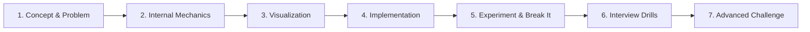

# Learning Guide: Mastering Engineering & Interview Excellence

Welcome to **Crack the Code**. This repository is not a passive reading library; it is an active, code-first engineering laboratory designed to take you from foundational concepts to Staff-level engineering and FAANG interview mastery.

---

## 🧭 The Core Learning Philosophy: Learn by Doing

Passive reading creates the illusion of competence. Real mastery happens when code fails, compilers throw errors, race conditions trigger, and you debug the root cause.

Every concept in this curriculum is taught along this 7-step spine:



1. **Concept**: Understand the fundamental engineering problem and real-world analogy.
2. **Internal Working**: Dissect how the CPU, operating system kernel, or language runtime handles it under the hood.
3. **Visualization**: Examine memory layout diagrams, stack/heap frames, and state transition graphs.
4. **Implementation**: Write complete, runnable code from scratch.
5. **Experiment**: Run intentional failure modes (e.g., race conditions, memory leaks, buffer overruns, slow receivers).
6. **Interview Questions**: Practice explaining the mechanism, trade-offs, and failure modes under interview constraints.
7. **Advanced Challenge**: Solve non-trivial engineering problems combining multiple subsystems.

---

## 📋 Prerequisites Map

| Subject | Minimum Starting Level | Recommended Preparation |
| :--- | :--- | :--- |
| **Modern C++** | Basic programming syntax (variables, loops, basic functions in any language) | Read Module 00 & 01; have a modern C++ compiler (`clang++` or `g++` with C++20 support). |
| **Python** | Beginner programming concepts | Read Module 00 & 01; install Python 3.12 or 3.13. |
| **Operating Systems** | Comfort with C/C++ syntax and basic terminal commands | Modules 00-01 introduce computer hardware, ELF binaries, and memory fundamentals. |
| **Computer Networks** | High-level understanding of the Internet | Follow sequentially from Module 00. |

---

## 🛠️ How to Study Each Learning Module

To maximize retention and interview performance, follow this exact routine for every module:

### Step 1: Read the Theory & Internal Working
* Open the module directory (e.g., `core-cs/operating-systems/07-synchronization-primitives/`).
* Read the `README.md` and `theory.md` thoroughly.
* Study the visual diagrams in `visual-explanation.md` or embedded Mermaid diagrams. Sketch the memory layout on paper.

### Step 2: Compile and Run Examples
* Navigate to the `examples/` directory.
* Read the source code comments before executing.
* Compile and run the code locally using the compilation instructions at the top of each file:
  ```bash
  clang++ -std=c++20 -Wall -Wextra -pthread example.cpp -o example && ./example
  ```
* Verify the output against the documented expected output.

### Step 3: Run the Experiments
* Open the `experiments/` directory.
* Run the experiment scripts. Note how intentional bugs (e.g., missing mutex lock, cache line contention) manifest in corrupted state or slower execution.
* Use tools like `valgrind`, AddressSanitizer (`-fsanitize=address`), or ThreadSanitizer (`-fsanitize=thread`).

### Step 4: Attempt Exercises Independently
* Work through the exercises in `exercises/` (Beginner, Intermediate, Advanced).
* **RULE**: Do NOT open the `solutions/` directory until you have spent at least 30 minutes attempting the exercise or have completed a working prototype.
* If stuck, write down your assumptions, inspect the error output with a debugger (`gdb` or `lldb`), and re-read the internal mechanics section.

### Step 5: Master the Interview Questions
* Open `interview-questions.md`.
* Cover the answers with a piece of paper or browser window.
* Practice answering out loud in 2 to 3 minutes, as if speaking to a FAANG interviewer.
* Articulate:
  1. High-level definition and why it exists.
  2. Concrete internal mechanism (how the OS or runtime implements it).
  3. Key engineering trade-offs (space vs time, latency vs throughput).
  4. Failure modes and common traps.

---

## 🔁 Spaced Repetition & Revision Strategy

* **End of Day**: Spend 15 minutes reviewing the memory diagrams and code traps learned during the day.
* **End of Week**: Take on one capstone project that weaves together all concepts covered that week.
* **Pre-Interview**: Switch to `INTERVIEW_PREPARATION.md` and follow Track A (7-Day Revision) or Track B (14-Day Intensive).
