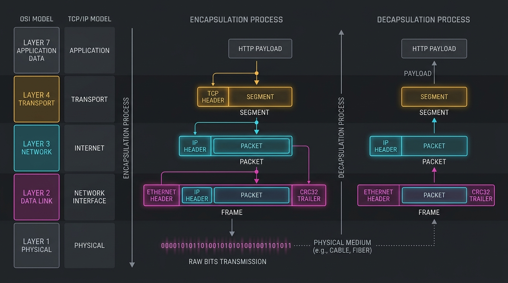

# Module 01: OSI and TCP/IP Layer Models

## Overview
Network communication is architected into layered abstractions. The 7-layer OSI (Open Systems Interconnection) reference model provides a theoretical framework for protocol separation of concerns, while the 4/5-layer TCP/IP protocol suite defines the pragmatic architecture that actually powers the global Internet.

In this module, you will master the mechanics of packet encapsulation, decapsulation, Protocol Data Units (PDUs), and dissect raw network frames down to the exact bitfields of Ethernet, IPv4, and TCP headers.

---

## 🖼️ Architectural Blueprint: Encapsulation & Decapsulation Pipeline

### Protocol Data Units (PDUs) Across Layers:
1. **Application Layer (Layer 7)**: Generates the raw application **Data/Payload** (e.g., `HTTP GET /index.html`).
2. **Transport Layer (Layer 4)**: Wraps Data with a TCP/UDP header containing Source & Destination Ports $\implies$ **Segment**.
3. **Network Layer (Layer 3)**: Wraps Segment with an IP header containing Source & Destination IP addresses $\implies$ **Packet**.
4. **Data Link Layer (Layer 2)**: Wraps Packet with an Ethernet header (MAC addresses) and adds a CRC32 Frame Check Sequence (FCS) trailer $\implies$ **Frame**.
5. **Physical Layer (Layer 1)**: Converts Frame into electronic voltage pulses, fiber light pulses, or radio waves $\implies$ **Bits**.

---

## Learning Objectives
1. **OSI 7-Layer vs TCP/IP 4-Layer**: Compare Layer 7 down to Layer 1, understanding the specific responsibilities of each tier.
2. **Encapsulation & Decapsulation**: Trace how application payloads are progressively wrapped in transport headers, network headers, and data-link frame headers and trailers.
3. **Protocol Data Units (PDUs)**: Master the exact terminology: Messages, Segments, Datagrams, Packets, Frames, and Bits.
4. **Header Wire Anatomy**: Analyze the exact bit-level structure of Ethernet II, IPv4, and TCP headers.
5. **Packet Dissection in Practice**: Implement a raw packet parser in C++ that inspects wire hex captures like Wireshark.

---

## Curriculum Structure
- `theory.md`: Theoretical comparison between OSI and TCP/IP, PDU definitions, and encapsulation dynamics.
- `internal-working.md`: Bit-by-bit header layouts (Ethernet, IPv4, TCP, UDP), byte ordering (Big-Endian vs Little-Endian), and MTU boundaries.
- `visual-explanation.md`: Visual encapsulation diagrams showing how data is nested and stripped across network devices.
- `examples/`:
  - `packet_dissector.cpp`: Complete C++ network frame dissector parsing raw packet byte arrays.
- `exercises/`: Wire format decoding and header extraction exercises.
- `solutions/`: Reference dissection solutions.
- `interview-questions.md`: FAANG interview questions (e.g. "Where do TLS, HTTP/2, and WebSockets sit in OSI?", "Why does TCP/IP dominate over OSI?").
- `common-mistakes.md`: Header size miscalculations, ignoring big-endian network byte order, confusing presentation/session responsibilities.
