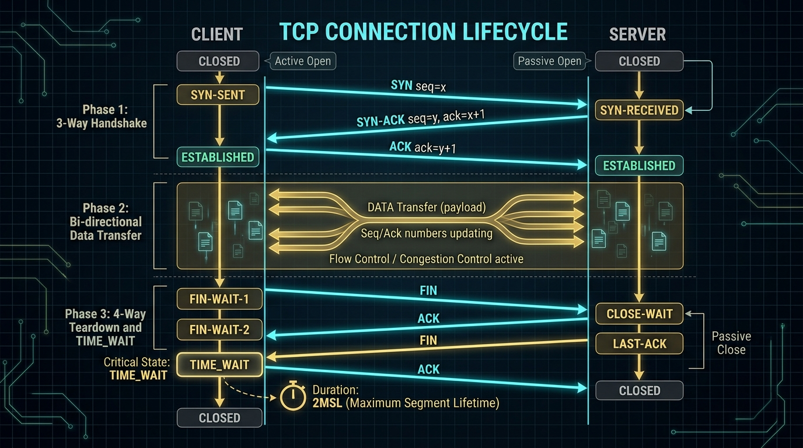

# Module 05: TCP Internals & Congestion Control

## Overview
Transmission Control Protocol (TCP, RFC 793) is the reliable backbone of the Internet. Beneath its simple byte-stream abstraction lies one of the most sophisticated distributed state machines ever engineered: sliding window flow control, dynamic RTT estimation, SYN cookie cryptographic defenses, fast retransmission, and state-of-the-art congestion control algorithms (Cubic, Google BBR).

In this module, you will master the deep internal mechanics of TCP state transitions, sequence number byte arithmetic, flow vs congestion control, the necessity of the `TIME_WAIT` state, and simulate congestion window dynamics in Modern C++.

---

## 🖼️ Architectural Blueprint: The TCP Connection Lifecycle

### Key Phase Transitions & Interview Questions:
1. **Phase 1: 3-Way Handshake**:
   - `Client` sends `SYN seq=x` (enters `SYN-SENT`).
   - `Server` responds with `SYN-ACK seq=y, ack=x+1` (enters `SYN-RECEIVED`).
   - `Client` replies with `ACK ack=y+1` (both enter `ESTABLISHED`).
2. **Phase 2: Bidirectional Data Transfer**:
   - Packets flow according to the sliding window protocol. Sequence numbers track payload bytes, and ACKs confirm the next expected byte offset.
3. **Phase 3: 4-Way Teardown & The TIME_WAIT State**:
   - Active closer sends `FIN`, enters `FIN-WAIT-1`.
   - Passive receiver sends `ACK`, enters `CLOSE-WAIT`. Active closer enters `FIN-WAIT-2`.
   - Passive receiver sends `FIN`, enters `LAST-ACK`.
   - Active closer sends `ACK`, enters **`TIME_WAIT`**!
   - **Why TIME_WAIT lasts 2MSL (Maximum Segment Lifetime)**:
     1. To guarantee the final `ACK` is reliably received by the peer (if lost, peer retransmits `FIN`, which is re-ACKed).
     2. To allow any stale duplicate packets lingering in network routers to dissipate before a new connection reuses the same 4-tuple (Source IP, Source Port, Dest IP, Dest Port).

---

## Learning Objectives
1. **The 3-Way Handshake**: Dissect SYN, SYN-ACK, ACK transitions, Initial Sequence Number (ISN) generation, MSS negotiation, and TCP Options (Window Scaling, SACK).
2. **SYN Flood Attacks & SYN Cookies**: Understand how half-open connection queues can exhaust server memory, and how stateless cryptographic sequence numbers (RFC 4987) defeat Denial of Service.
3. **Sliding Window Flow Control**: Master byte-offset sequence arithmetic, advertised receive windows (`rwnd`), and Zero-Window persist timers.
4. **Connection Teardown & TIME_WAIT**: Learn why `TIME_WAIT` must persist for $2 \times \text{MSL}$ (Maximum Segment Lifetime), and how to safely handle socket churn via `SO_REUSEADDR` and `tcp_tw_reuse`.
5. **Congestion Control Evolution**:
   - Understand the difference between Flow Control (`rwnd`) and Congestion Control (`cwnd`).
   - Contrast AIMD, Slow Start, Fast Retransmit (3 duplicate ACKs), and Fast Recovery.
   - Compare loss-based algorithms (Reno, Cubic) with Google's delay/bandwidth-based model (**BBR** - Bottleneck Bandwidth and RTT).

---

## Curriculum Structure
- `theory.md`: Theoretical foundations of TCP state machines, sliding window mathematics, and congestion control algorithms.
- `internal-working.md`: TCP Control Block (`struct tcp_sock`), RTO calculation (Jacobson/Karels algorithm), SYN cookies hash formula, and SACK scoreboard.
- `visual-explanation.md`: State machine diagrams, packet sequence waterfalls, and `cwnd` growth curves (Reno vs Cubic vs BBR).
- `examples/`:
  - `tcp_congestion_simulator.cpp`: Complete C++ simulator tracking `cwnd` growth across Slow Start, Congestion Avoidance, Fast Retransmit, and BBR pacing.
- `exercises/`: TCP sequence math, RTO calculation, and congestion control tracing exercises.
- `solutions/`: Rigorous step-by-step solutions.
- `interview-questions.md`: High-frequency FAANG questions (e.g. "Explain TIME_WAIT and why it cannot be set to 0", "Cubic vs BBR", "Why is initial sequence number randomized?").
- `common-mistakes.md`: Nagle's algorithm + Delayed ACK interaction, bufferbloat in drop-tail queues, conflating flow control with congestion control.
