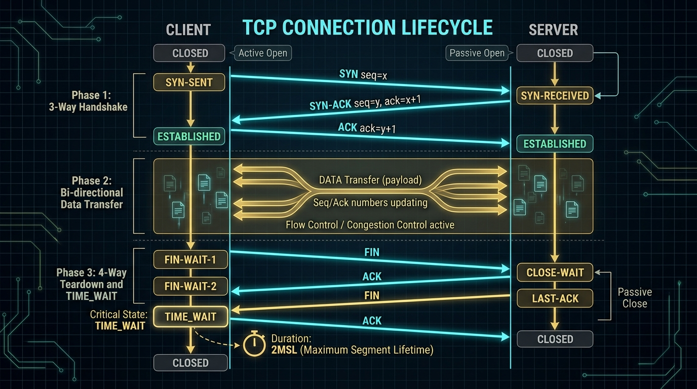
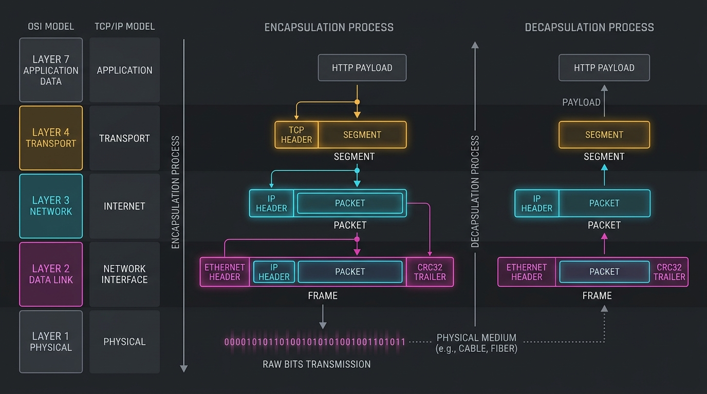

# Computer Networks Curriculum: Zero to Systems & Distributed Engineering Mastery

This curriculum covers the complete networking stack from physical and data-link framing to the transport layer (TCP/UDP/QUIC), socket programming, TLS 1.3 cryptographic handshakes, HTTP/1.1/2/3, DNS, and high-performance network programming for FAANG-level engineering interviews.

> [!TIP]
> **📖 Start Reading Here**: Begin your journey with **[Module 00: Networking Fundamentals](00-networking-fundamentals/README.md)**. Use the **Next Chapter ➡️** buttons at the bottom of each module to progress through all 13 chapters sequentially!

---

## 🖼️ Architectural Visualizations

### 1. TCP Connection Lifecycle: Handshake, Transfer & 4-Way Teardown
State transitions and sequence arithmetic governing reliable data transport across the internet:



### 2. Packet Encapsulation & Decapsulation Pipeline
How application payloads are wrapped in transport segments, IP packets, and link frames down to physical wire bits:



---

## 🗺️ Curriculum Structure

```
computer-networks/
├── 00-networking-fundamentals/         # Topologies, Packet vs Circuit Switching, Latency, Bandwidth, Jitter
├── 01-osi-and-tcp-ip-model/            # 7-layer OSI vs 4-layer TCP/IP, Encapsulation, Headers, Packet anatomy
├── 02-ip-addressing-and-subnetting/    # IPv4/IPv6, CIDR notation, Subnet masks, VLSM, Subnet Calculator
├── 03-ethernet-arp-and-switching/      # Ethernet frame, MAC address, ARP table, Switching, VLANs
├── 04-transport-layer/                 # Ports, Demuxing, UDP vs TCP, Checksumming, TCP/UDP headers
├── 05-tcp-internals/                   # 3-Way handshake, Sequence arithmetic, Sliding window, Congestion control (Cubic/BBR), TIME_WAIT
├── 06-udp-and-quic/                    # UDP mechanics, Head-of-line blocking, QUIC protocol, 0-RTT, HTTP/3
├── 07-sockets-programming/             # Berkeley sockets API, TCP/UDP client-server, socket options (SO_REUSEADDR, TCP_NODELAY)
├── 08-dns/                             # Hierarchy, Recursive vs Iterative resolution, Record types, DNS caching, DoH/DoT
├── 09-http-and-https/                  # HTTP/1.1 vs HTTP/2 vs HTTP/3, Multiplexing, HPACK, RESTful design
├── 10-tls-and-security/                # Public key crypto, TLS 1.2 vs 1.3 handshake, Certificates, Forward secrecy
├── 11-network-performance/             # Bandwidth-Delay Product (BDP), Bufferbloat, TCP tuning, CDN architecture
├── 12-network-programming/             # Non-blocking sockets, I/O multiplexing (epoll/kqueue), Reactor pattern
│
└── projects/                           # 7 Production Networking Projects
    ├── 01-tcp-chat-app/                # Bidirectional client-server chat
    ├── 02-multiclient-chat-server/     # Multi-client broadcast chat server
    ├── 03-http-server-from-scratch/    # HTTP/1.1 static file & REST server
    ├── 04-simple-http-client/          # Low-level socket HTTP client
    ├── 05-nonblocking-eventloop-server/# Single-threaded reactor event loop server
    ├── 06-multithreaded-file-transfer/ # Chunked reliable TCP file transfer
    └── 07-dns-lookup-cache/            # DNS resolver with TTL LRU cache
```

---

## 💡 Methodology Applied: Learn by Doing

Every module is organized into:
1. **`README.md` & `theory.md`**: Core models, network physics, protocols, standards (RFCs), and architectural trade-offs.
2. **`internal-working.md`**: Wire formats, packet header bitfields, kernel socket buffers (`sk_buff`), state machine transitions.
3. **`visual-explanation.md`**: ASCII sequence diagrams, packet framing maps, and timing waterfall charts.
4. **`examples/`**: Compilable, self-contained C++ implementations tested with `-Wall -Wextra -Wpedantic`.
5. **`exercises/` & `solutions/`**: Rigorous problem sets with reference implementations.
6. **`interview-questions.md`**: Comprehensive FAANG interview questions (e.g. "What happens when you type google.com into your browser?").
7. **`common-mistakes.md`**: Production network bugs (e.g., TIME_WAIT socket exhaustion, Nagle's algorithm delay, forgetting network byte order `htons`).
