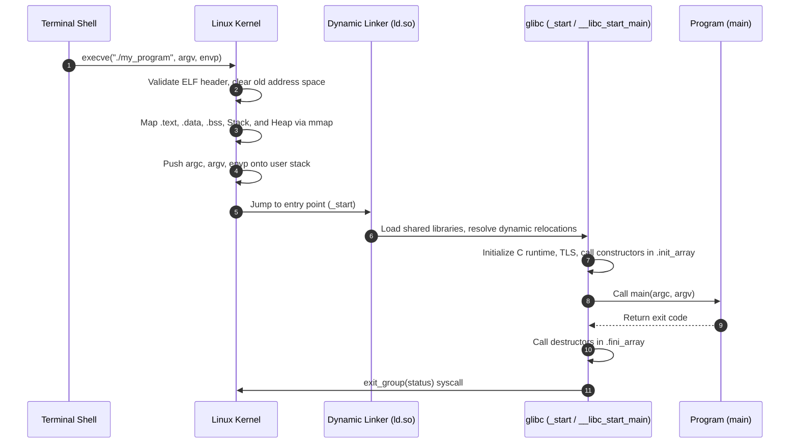

# Internal Working: From Source Code to Running Process

## 1. The Compilation Pipeline

When you invoke `g++ main.cpp -o main`, four distinct tools execute in sequence:

```
Source Code (.cpp)
    │
    ▼ [1. Preprocessor (cpp)]
Expanded Source (.ii)
    │
    ▼ [2. Compiler (cc1plus)]
Assembly Code (.s)
    │
    ▼ [3. Assembler (as)]
Relocatable Object File (.o)
    │
    ▼ [4. Linker (ld)]
Executable Binary (ELF / Mach-O)
```

1. **Preprocessing (`cpp`)**: Strips comments, expands macros (`#define`), and recursively pastes included headers (`#include`).
2. **Compilation (`cc1plus`)**: Parses C++ syntax, performs type-checking, constructs Abstract Syntax Trees (AST), generates intermediate representations (e.g. LLVM IR or GCC GIMPLE), performs optimization passes (inlining, loop unrolling, dead-code elimination), and emits target assembly code.
3. **Assembly (`as`)**: Translates assembly mnemonics (`mov`, `add`, `call`) into raw machine code and creates relocatable symbols, outputting an object file (`.o`).
4. **Linking (`ld`)**: Resolves symbol references across multiple translation units and libraries, merges identical sections, performs address relocation, and constructs the final binary.

---

## 2. Static vs Dynamic Linking

| Feature | Static Linking (`.a` / `.lib`) | Dynamic Linking (`.so` / `.dylib` / `.dll`) |
| :--- | :--- | :--- |
| **Link Time** | All library code is copied into the binary at build time. | Only symbol stubs and the dynamic linker request are added. |
| **Binary Size** | Large (contains full library code). | Compact (shares library code on disk). |
| **Memory Footprint**| Every running process has its own copy of the library in RAM. | Physical RAM pages of `.text` are shared across all processes. |
| **Updates/Patches** | Requires recompiling and relinking the entire application. | Updating the `.so` on disk updates all applications on next run. |
| **Startup Speed** | Faster initial startup (no runtime symbol resolution). | Slight startup overhead (dynamic loader `ld.so` relocates symbols). |

---

## 3. Structure of an Executable (ELF & Segments)

On Linux, binaries conform to the **Executable and Linkable Format (ELF)**. In memory, the process address space is organized into well-defined segments:

```
High Addresses (0x7FFFFFFFFFFF on x86-64)
┌──────────────────────────────────────────────┐
│ Kernel Space (Inaccessible to User Space)    │
├──────────────────────────────────────────────┤
│ Command-Line Arguments & Environment (argv)  │
├──────────────────────────────────────────────┤
│ STACK (Grows downward ↓)                     │
│ [Stack frames: return addresses, local vars] │
├──────────────────────────────────────────────┤
│                   ↓                          │
│                                              │
│                   ↑                          │
├──────────────────────────────────────────────┤
│ Memory Mapping Region (mmap, shared libs)    │
├──────────────────────────────────────────────┤
│                   ↑                          │
│ HEAP (Grows upward ↑)                        │
│ [Dynamic allocations via malloc/new / brk]   │
├──────────────────────────────────────────────┤
│ .bss Section                                 │
│ [Uninitialized global & static variables]    │
├──────────────────────────────────────────────┤
│ .data Section                                │
│ [Initialized global & static variables]      │
├──────────────────────────────────────────────┤
│ .rodata Section                              │
│ [Read-only data: string literals, consts]    │
├──────────────────────────────────────────────┤
│ .text Section                                │
│ [Compiled machine instructions (Code)]       │
└──────────────────────────────────────────────┘
Low Addresses (0x0000000000400000)
```

### Key Section Distinctions
* **`.text`**: Contains compiled executable CPU instructions. Marked **Read-Only + Execute (RX)**. Writing here triggers a Segmentation Fault (`SIGSEGV`).
* **`.rodata`**: Contains string literals and compile-time constants. Marked **Read-Only (R)**.
* **`.data`**: Contains global/static variables with non-zero initial values. Marked **Read-Write (RW)**.
* **`.bss`**: Block Started by Symbol. Contains global/static variables initialized to zero or uninitialized. *Does not consume disk space in the binary*; the kernel allocates zero-filled pages on process launch.

---

## 4. The Process Launch Lifecycle: Before `main()`

What actually happens when a user types `./my_program` in a terminal?


