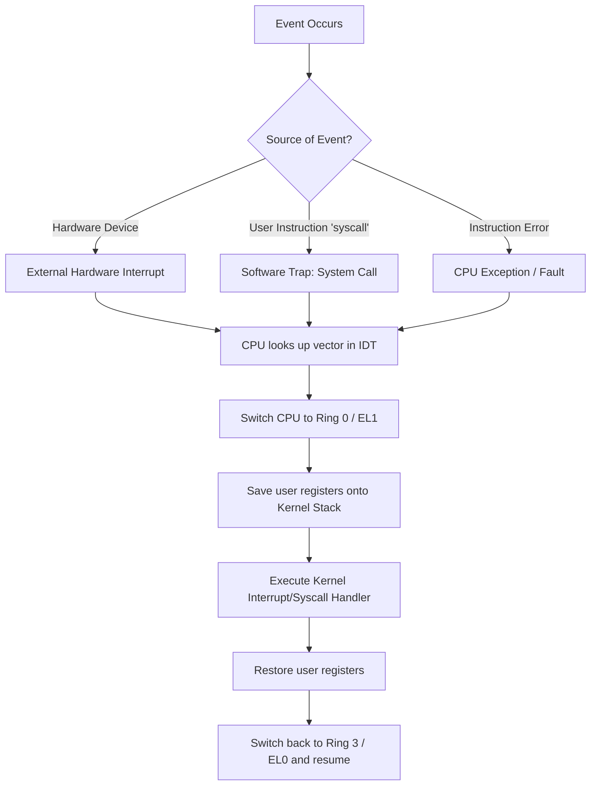

# Visual Explanation: Hardware Modes, Traps, and Memory Segments

## 1. CPU Privilege Level Switching (Ring 3 vs Ring 0)

A user application cannot access hardware or kernel structures directly. To request services, the CPU switches privilege levels via a hardware trap.

```
       USER SPACE (Ring 3)                         KERNEL SPACE (Ring 0)
┌─────────────────────────────────┐         ┌─────────────────────────────────┐
│ User Program                    │         │ Kernel Core                     │
│                                 │         │                                 │
│  buffer = "Hello\n";            │         │                                 │
│  write(1, buffer, 6);           │         │                                 │
│        │                        │         │                                 │
│        ▼                        │         │                                 │
│  [glibc wrapper]                │         │                                 │
│  mov rax, 1        (SYS_write)  │         │                                 │
│  mov rdi, 1        (stdout fd)  │         │                                 │
│  mov rsi, buffer   (ptr)        │         │                                 │
│  mov rdx, 6        (length)     │         │                                 │
│  syscall           ───TRAP───►  │         │  Save CPU Registers (pt_regs)   │
│                                 │         │  Verify user pointer validity   │
│                                 │         │  VFS -> tty_write() -> driver   │
│                                 │         │  Place return value into RAX    │
│  sysret            ◄──RETURN─── │         │  Restore CPU Registers          │
│        │                        │         │                                 │
│        ▼                        │         │                                 │
│  Resume execution at next IP    │         │                                 │
└─────────────────────────────────┘         └─────────────────────────────────┘
```

---

## 2. Process Memory Segment Architecture

```
Address (64-bit)
0x7FFFFFFFFFFF ┌───────────────────────────────────────────────┐
               │ Kernel Virtual Memory (Inaccessible in Ring 3)│
0x7FFF00000000 ├───────────────────────────────────────────────┤
               │ Stack (Grows Downward)                        │
               │ [Local variables, function return addresses]  │
               │                   │                           │
               │                   ▼                           │
               │                                               │
               │                   ▲                           │
               │                   │                           │
               │ Memory Mapping Segment (mmap, .so libraries)  │
               │                                               │
               │                   ▲                           │
               │                   │                           │
               │ Heap (Grows Upward via brk/sbrk / mmap)       │
               │ [Dynamic objects: malloc, new]                │
               ├───────────────────────────────────────────────┤
               │ .bss (Uninitialized global / static data)     │
               │ [Zero-filled pages]                           │
               ├───────────────────────────────────────────────┤
               │ .data (Initialized global / static data)      │
               │ [Read/Write]                                  │
               ├───────────────────────────────────────────────┤
               │ .rodata (Read-Only Data, String Literals)     │
               │ [Read-Only]                                   │
               ├───────────────────────────────────────────────┤
               │ .text (Compiled Machine Instructions)         │
               │ [Read-Only + Execute]                         │
0x000000400000 └───────────────────────────────────────────────┘
```

---

## 3. Interrupt Descriptor Table (IDT) Dispatching


