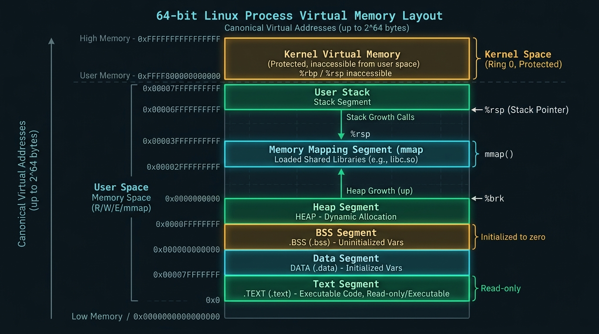

# Module 01: Processes & Threads

Processes and threads are the core abstractions by which an Operating System executes concurrent programs. Understanding their isolation boundaries, kernel representations, and performance costs is critical for systems programming and backend concurrency.

---

## 🖼️ Memory Architecture: The 64-bit Virtual Address Space

Every Linux process runs inside a canonical 64-bit virtual address space, strictly dividing kernel privileges from user execution:

### Segment Breakdown:
1. **Kernel Virtual Memory (Top)**: Mapped into every process but protected by CPU ring privilege levels. User code attempting to access it triggers a `SIGSEGV` (Segmentation Fault).
2. **User Stack (Grows Downward)**: Stores local variables, function frames, return addresses, and register backups. Tracked by the `%rsp` stack pointer register.
3. **Memory Mapping Segment (`mmap`)**: Dynamically loaded shared libraries (`libc.so`), memory-mapped files, and large memory allocations.
4. **Heap Segment (Grows Upward)**: Dynamic runtime memory requested via `malloc()` / `new`. Managed by `brk` and `sbrk` kernel boundaries.
5. **BSS Segment**: Block Started by Symbol. Stores uninitialized global and static variables, zero-initialized by the kernel at program start.
6. **Data Segment**: Initialized global and static variables explicitly assigned values in source code.
7. **Text Segment (Bottom)**: Read-only executable binary machine code instructions. Writing to `.text` triggers an immediate segmentation fault.

---

## 📑 Module Contents

1. [Theory & Concepts](theory.md)
   * Program vs Process vs Thread.
   * Process State Lifecycle: Ready, Running, Blocked, Terminated, Zombie.
   * Process Control Block (PCB) vs Thread Control Block (TCB).
   * Threading Models: 1:1 (Kernel-level), N:1 (User-level / Green threads), M:N (Hybrid).
   * Shared vs Thread-Private resources.
2. [Internal Working](internal-working.md)
   * Linux `clone()` system call: The unified primitive behind `fork()` and `pthread_create()`.
   * Zombie process mechanics and reaping via `waitpid()`.
   * Orphan adoption by PID 1 (`init` / `systemd`).
   * Thread-Local Storage (`thread_local`) runtime implementation.
   * What happens when `fork()` is called in a multithreaded application.
3. [Visual Explanations](visual-explanation.md)
   * Process state machine transition diagram.
   * Memory layout comparison: Two distinct processes vs Two threads sharing an address space.
4. [Examples & Code](examples/)
   * `fork_exec_wait.cpp`: Clean, robust parent-child process lifecycle with `fork()`, `execvp()`, and `waitpid()`.
   * `process_vs_thread_memory.cpp`: Demonstrates data isolation in child processes vs memory sharing and race conditions in threads.
5. [Experiments](experiments/)
   * `benchmark_process_vs_thread.cpp`: Measures latency of spawning 10,000 processes vs 10,000 threads.
   * `zombie_orphan_demo.cpp`: Creates and monitors real zombie and orphan states using CLI tools (`ps`).
6. [Exercises & Solutions](exercises/exercises.md)
   * Beginner, Intermediate, and Advanced exercises on process trees and signal management.
7. [Interview Questions & Deep Dives](interview-questions.md)
   * Critical FAANG questions: Thread stacks, resource sharing, `fork()` safety in multithreaded code.
8. [Common Mistakes](common-mistakes.md)
   * Fork bombs, failure to reap zombies, and accessing destroyed thread-local variables.
