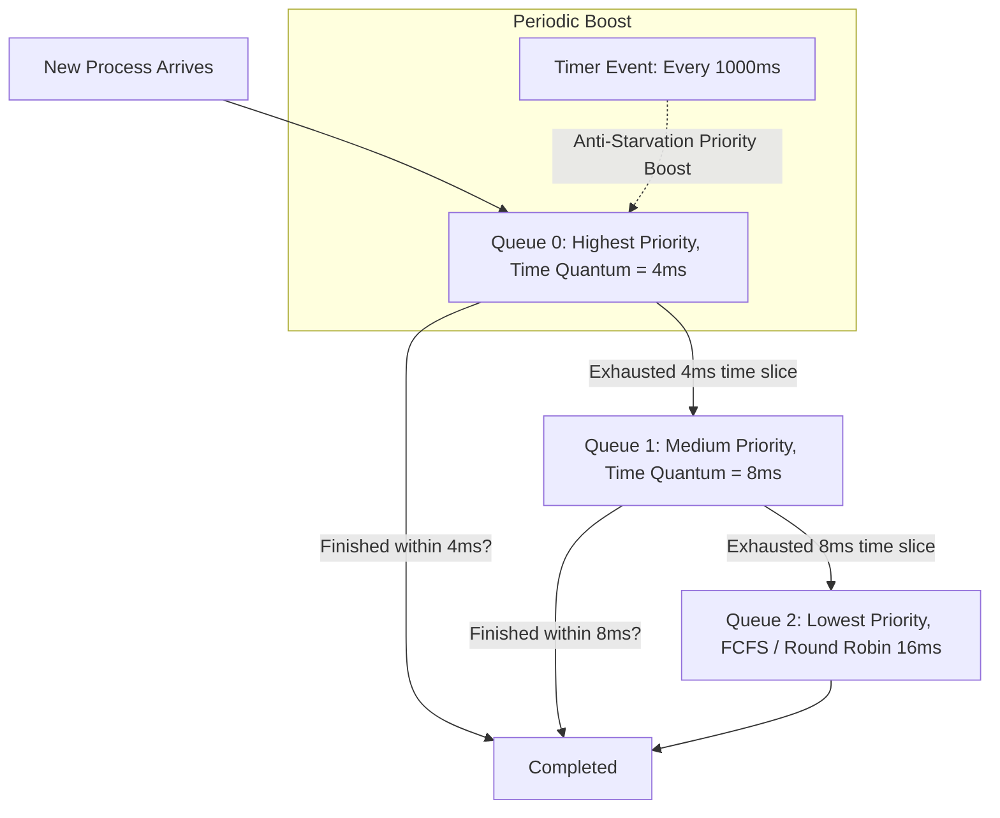

# Visual Explanation: CPU Scheduling & Gantt Charts

## 1. The FCFS Convoy Effect vs SJF

Consider three processes:
- $P_1$: Burst time = 24 ms (arrives at $t=0$)
- $P_2$: Burst time = 3 ms (arrives at $t=0$)
- $P_3$: Burst time = 3 ms (arrives at $t=0$)

### First-Come, First-Served (FCFS) Gantt Chart:
```
0                               24         27         30
┌───────────────────────────────┬──────────┬──────────┐
│              P1               │    P2    │    P3    │
└───────────────────────────────┴──────────┴──────────┘
Waiting times: P1 = 0 ms, P2 = 24 ms, P3 = 27 ms.
Average Waiting Time = (0 + 24 + 27) / 3 = 17.0 ms!
(P2 and P3 are stuck in the "Convoy" behind the large truck P1).
```

---

### Shortest Job First (SJF) Gantt Chart:
```
0      3      6                                       30
┌──────┬──────┬───────────────────────────────────────┐
│  P2  │  P3  │                  P1                   │
└──────┴──────┴───────────────────────────────────────┘
Waiting times: P2 = 0 ms, P3 = 3 ms, P1 = 6 ms.
Average Waiting Time = (0 + 3 + 6) / 3 = 3.0 ms!
(Reordering reduced average waiting time from 17.0 ms to 3.0 ms — an 82% improvement!)
```

---

## 2. Round Robin Time Quantum Selection Curve

```
Overhead /
Response
   ▲
   │  Context Switch Overhead
   │  (Thrashing / Cache Misses)
   │  \
   │   \
   │    \                     Average Response Time
   │     \                   / (Sluggish UI / High latency)
   │      \                 /
   │       \               /
   │        \             /
   │         `---.__.---'   ◄── OPTIMAL SWEET SPOT
   │                            (Typically 10ms - 20ms)
   └──────────────────────────────────────────────────► Time Quantum (q)
```

---

## 3. Multilevel Feedback Queue (MLFQ) Priority Flow


