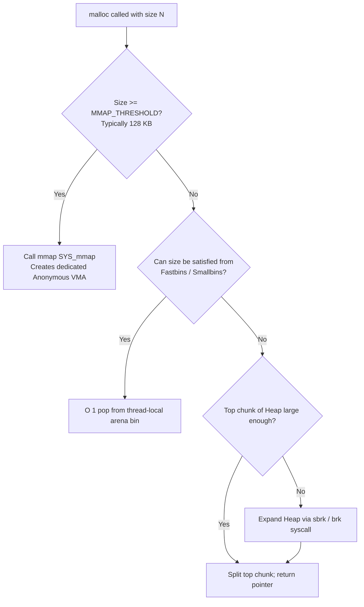

# Internal Working: `malloc()` Internals, `brk()` vs `mmap()`, and Cache Locality

## 1. What Happens Inside `malloc(size)`?

When user code invokes `void* ptr = malloc(size);`:

### The System Call Level: `brk()` vs `mmap()`

1. **`brk(addr)` / `sbrk(incr)` (The Program Break)**:
   - The "program break" is the memory address marking the end of the process's data/heap segment.
   - For small allocations (< 128 KB), glibc moves the break upward via `brk()`.
   - When user code calls `free()`, memory is **not returned to the OS kernel**; it is placed into glibc's free bins so future `malloc()` calls avoid system calls.
2. **`mmap(MAP_ANONYMOUS | MAP_PRIVATE)`**:
   - For large allocations ($\ge$ 128 KB), glibc requests dedicated virtual pages directly from the kernel.
   - Calling `free()` on an mmap-allocated chunk immediately invokes `munmap()`, returning the physical memory back to the OS.

---

## 2. Glibc `ptmalloc` Architecture

To prevent lock contention in multithreaded applications, modern allocators use **Arenas**:
- **Main Arena**: Manages the heap grown via `brk()`.
- **Thread Arenas**: Additional arenas allocated via `mmap()` so threads can allocate concurrently without contending on a global mutex. (Max arenas = $8 \times \text{CPU Cores}$).

Inside each arena, freed chunks are categorized into **Bins**:
1. **Fastbins**: Singly linked lists for small chunks (16–80 bytes). Kept hot in L1 cache; never coalesced immediately with neighbors.
2. **Unsorted Bin**: The arrival lounge. Newly freed chunks are deposited here first to exploit temporal locality.
3. **Smallbins**: Doubly linked lists for chunks < 512 bytes, sorted by size.
4. **Largebins**: Doubly linked lists for chunks $\ge$ 512 bytes, sorted by size and address.

---

## 3. Hardware Cache Lines & Spatial Locality

Modern CPUs transfer data between L1/L2 caches and DRAM in **64-byte Cache Lines**:
- If you access a single 4-byte integer at address `0x1000`, the hardware memory controller fetches the entire 64-byte block (`0x1000` to `0x103F`) into L1 cache.
- **Spatial Locality**: Storing related data contiguously (e.g. `std::vector`) ensures the remaining 60 bytes already reside in L1 cache, turning 15 subsequent lookups into 1-cycle cache hits.
- **Pointer Chasing (Linked Lists)**: Allocating nodes randomly across the heap destroys cache locality. Each node dereference incurs a full DRAM round-trip (~60–100 ns).
