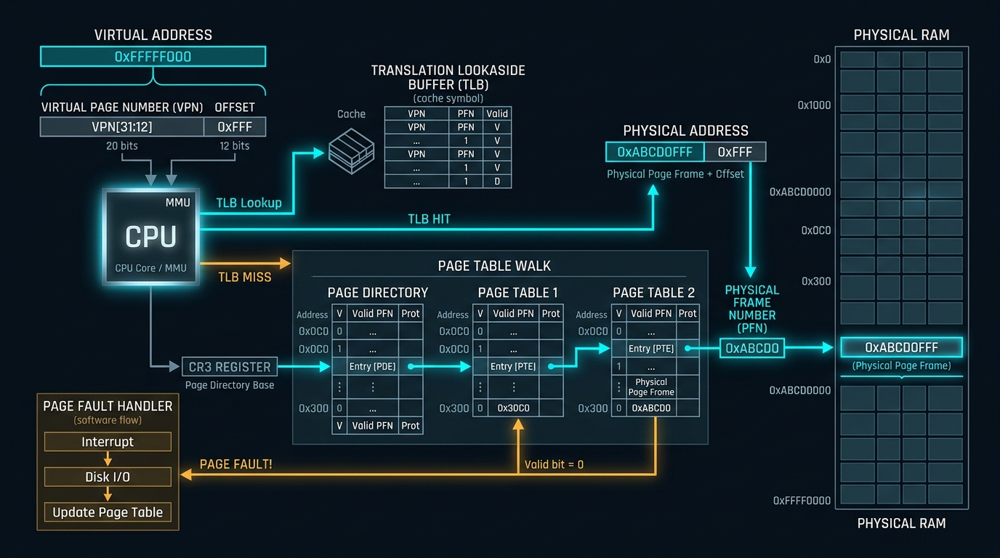

# Module 05: Virtual Memory & Address Translation

<!-- Chapter Navigation Header -->
| ⬅️ [Module 04: Memory Management](../04-memory-management/README.md) | 🏠 [Operating Systems Hub](../README.md) | [Module 06: Paging & Segmentation](../06-paging-and-segmentation/README.md) ➡️ |
|:---|:---:|---:|
<!-- /Chapter Navigation Header -->

Virtual Memory is one of the greatest abstractions in computer systems. It provides every process with the illusion of an enormous, contiguous, and private address space while transparently mapping, protecting, and sharing physical DRAM underneath.

---

## 🖼️ Architectural Blueprint: Virtual Memory & Page Translation

### Step-by-Step Hardware Translation Flow:
1. **Virtual Address Split**: The CPU splits the virtual address into the **Virtual Page Number (VPN)** and the **Offset**.
2. **TLB Fast Cache Check**: The Memory Management Unit (MMU) checks the **Translation Lookaside Buffer (TLB)**. If present (TLB Hit), the physical frame number is returned in ~1 CPU cycle!
3. **Hardware Page Table Walk**: On a TLB Miss, the MMU reads the **CR3 register** and walks the hierarchical page directory tables in RAM.
4. **Physical Frame Assembly**: The Physical Frame Number (PFN) is combined with the original Offset to access physical DRAM.
5. **Page Fault Interception**: If the PTE's `Valid/Present` bit is 0, the CPU triggers a Page Fault hardware interrupt, pausing the thread and letting the kernel swap the page in from disk.

---

## 📑 Module Contents

1. [Theory & Architectural Foundations](theory.md)
   * The Motivation for Virtual Memory: Protection, Isolation, Resource Sharing, and Overcommit.
   * Virtual vs Physical Addresses.
   * The Memory Management Unit (MMU) & Address Translation.
   * Structure of a Page Table Entry (PTE): Present bit, R/W bit, User/Supervisor bit, Dirty bit, Accessed bit.
   * Multi-Level Page Tables: Why 4-level (PML4) and 5-level paging exist.
2. [Internal Working](internal-working.md)
   * Translation Lookaside Buffer (TLB) hits, misses, and Hardware Page Table Walks.
   * Anatomy of a Page Fault: Minor vs Major vs Invalid (`SIGSEGV`).
   * Demand Paging: Lazy physical frame allocation on first write.
   * Copy-on-Write (COW): How `fork()` creates instantaneous process duplicates.
3. [Visual Explanations](visual-explanation.md)
   * 4-Level Virtual Address Decomposition (x86-64 48-bit address translation diagram).
   * Page fault handling workflow inside the Linux kernel.
   * Copy-on-Write memory page splitting.
4. [Examples & Code](examples/)
   * `page_fault_benchmark.cpp`: Measures and proves Demand Paging by tracking Minor Page Faults (`getrusage`) when touching freshly allocated virtual pages.
   * `copy_on_write_demo.cpp`: Demonstrates Copy-on-Write page splitting after `fork()`, proving zero-overhead process duplication.
5. [Exercises & Solutions](exercises/exercises.md)
   * Multi-level page table size calculations, page table offset bitmasking, and COW cost analysis.
6. [Interview Questions & Deep Dives](interview-questions.md)
   * Critical FAANG questions: Page fault step-by-step trace, why 64-bit systems need multi-level tables, COW hazards.
7. [Common Mistakes](common-mistakes.md)
   * Equating Virtual Size (VSZ) with Resident Set Size (RSS), forgetting dirty page flushing.

---

<!-- Chapter Navigation Footer -->
| ⬅️ Previous Chapter | 🏠 Up to Track Hub | Next Chapter ➡️ |
|:---|:---:|---:|
| [Module 04: Memory Management](../04-memory-management/README.md) | [Operating Systems Hub](../README.md) | **[Module 06: Paging & Segmentation](../06-paging-and-segmentation/README.md)** |
<!-- /Chapter Navigation Footer -->

