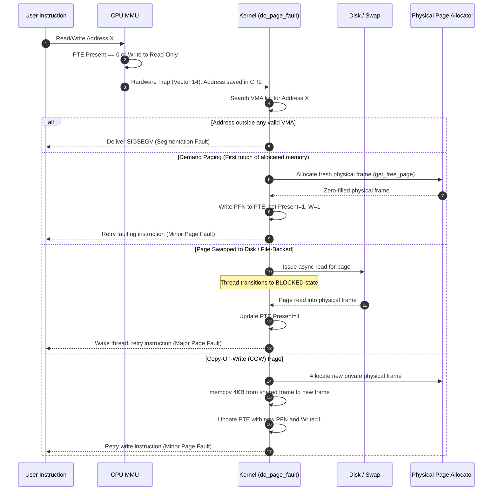

# Internal Working: Page Faults, TLB Walks, and Copy-On-Write (COW)

## 1. The Translation Lookaside Buffer (TLB)

Because 4-level paging requires 4 sequential memory reads just to translate an address, executing code without hardware caching would be $4\times$ slower.

The **Translation Lookaside Buffer (TLB)** is an on-chip associative cache built directly into the CPU:
- **TLB Hit**: Address translation takes **~0.5 to 1 clock cycle**.
- **TLB Miss**: The CPU MMU hardware halts instruction execution and performs a **Hardware Page Table Walk**:
  1. Reads `CR3` register to locate physical base of PML4.
  2. Reads PML4 entry $\to$ points to PDPT.
  3. Reads PDPT entry $\to$ points to Page Directory (PD).
  4. Reads PD entry $\to$ points to Page Table (PT).
  5. Reads PT entry $\to$ extracts Physical Frame Number (PFN).
  6. Loads the translation into the TLB and completes the memory access.
- Total miss penalty: ~40–100 nanoseconds.

---

## 2. Anatomy of a Page Fault

When an instruction accesses a virtual address whose PTE has the **Present bit = 0**, the CPU halts execution and fires a **Page Fault Exception (Vector 14)**:

---

## 3. Copy-on-Write (COW) Deep Dive

Historically, Unix `fork()` made a complete physical duplicate of the parent process's memory. If a parent occupied 16 GB of RAM, `fork()` spent seconds copying 16 GB across the bus—only for the child to immediately call `execve()` and discard the copied memory!

### How Modern Linux Implements COW:
1. When `fork()` is called, the kernel copies only the **page table structures**, NOT the physical RAM pages.
2. In the page tables of **both parent and child**, every writable page is marked **Read-Only** (`W = 0`).
3. An internal reference counter on the physical frame is incremented: `page->count = 2`.
4. As long as both processes only read from memory, they read from the exact same physical DRAM frames.
5. **The First Write**:
   - When either process writes to a page, the CPU encounters `W = 0` and triggers a Page Fault.
   - The kernel inspects the page metadata: It sees the page is marked COW and `page->count > 1`.
   - The kernel allocates a single 4 KB physical frame, copies the 4096 bytes into it, decrements the old frame's counter, maps the new frame into the writing process's PTE, marks it **Read-Write** (`W = 1`), and flushes the TLB.
   - The writing process resumes seamlessly.
   - **Result**: `fork()` completes in microseconds regardless of whether the parent process is using 10 MB or 100 GB of memory!
