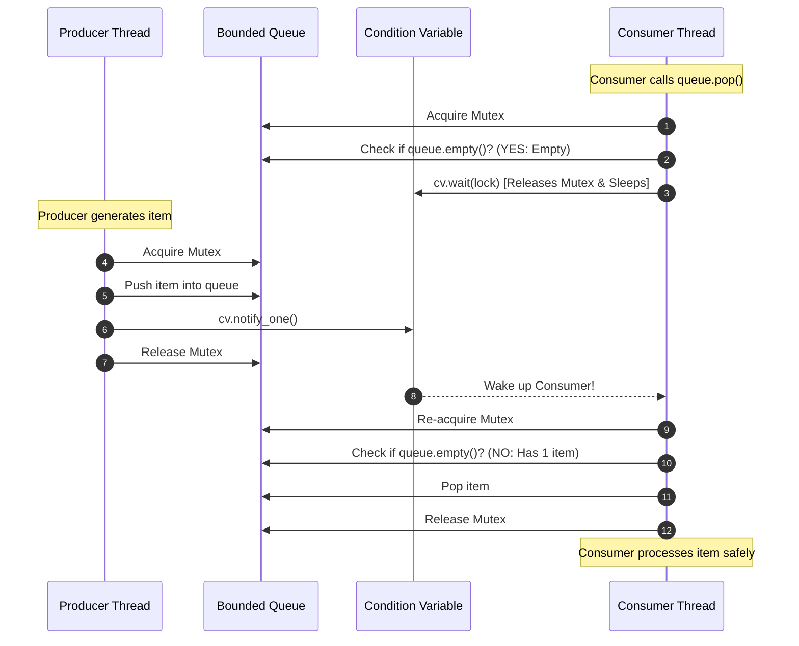

# Visual Explanation: Race Conditions & Synchronization Flows

## 1. Timeline of a Race Condition (Lost Update)

Two threads increment a shared counter without synchronization: `counter++`.
At the assembly level, `counter++` is THREE separate instructions:
1. `mov eax, [counter]` (Read)
2. `add eax, 1` (Modify)
3. `mov [counter], eax` (Write)

```
Time   Thread 1                        Thread 2                        Shared Counter Value
 │                                                                           0
 ▼     1. Read [counter] -> EAX = 0                                          0
       2. Add 1 -> EAX = 1                                                   0
       ──────────────────────────── CONTEXT SWITCH ────────────────────────
                                       1. Read [counter] -> EAX = 0          0
                                       2. Add 1 -> EAX = 1                   0
                                       3. Write EAX (1) -> [counter]         1
       ──────────────────────────── CONTEXT SWITCH ────────────────────────
       3. Write EAX (1) -> [counter]                                         1 (LOST UPDATE!)
```
Both threads incremented the counter, but the final value is **1 instead of 2**!

---

## 2. Condition Variable Producer-Consumer State Flow


