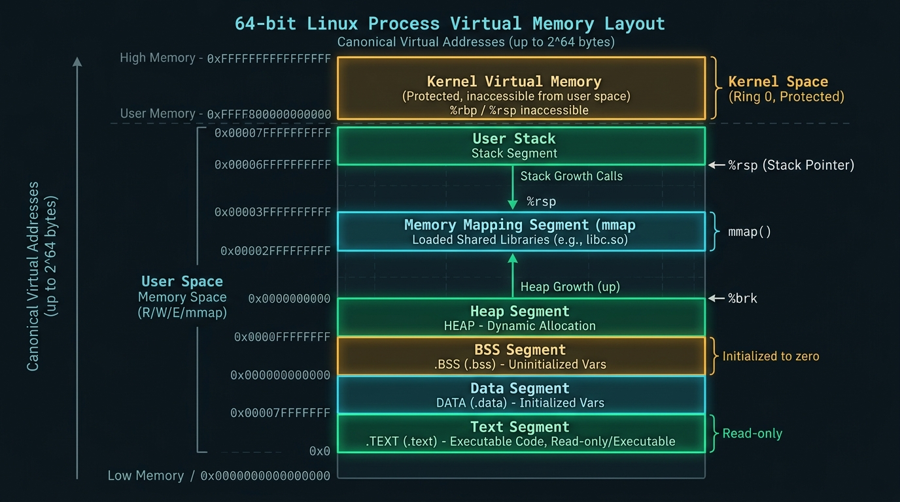
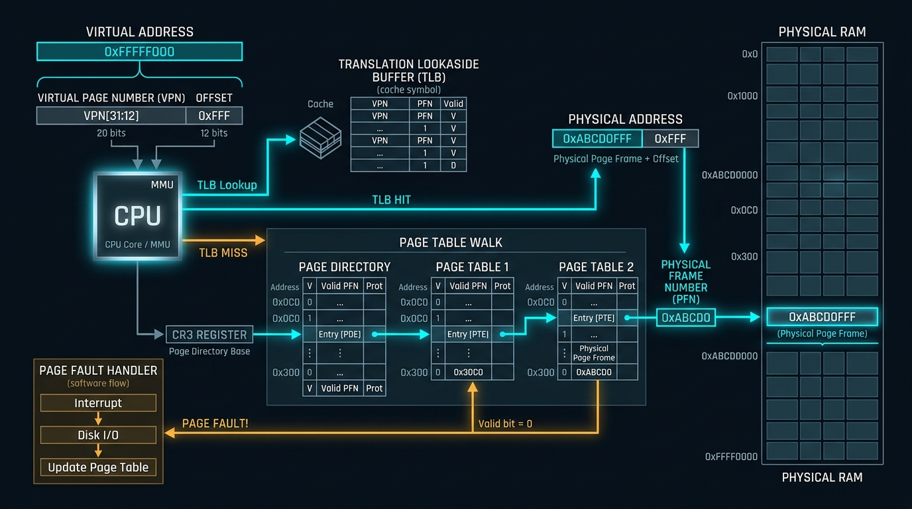

# Operating Systems Curriculum: Zero to Systems Engineering Mastery

This curriculum takes software engineers from fundamental hardware interactions to Linux kernel architecture, multi-core concurrency, virtual memory subsystems, and production-grade systems programming using Modern C++ (C++17/C++20) and POSIX/Linux APIs.

---

## 🖼️ Architectural Visualizations

### 1. 64-bit Linux Process Virtual Memory Layout
Every running Linux process operates within its own private virtual address space, isolating it from all other processes:



### 2. Virtual Memory Translation & Multi-Level Paging
How the Memory Management Unit (MMU) converts virtual addresses into physical RAM frames using the TLB cache and hierarchical page tables:



---

## 🗺️ Curriculum Structure

```
operating-systems/
├── 00-computer-fundamentals/         # CPU, Registers, Cache, Kernel vs User Mode, ELF, Syscalls
├── 01-processes-and-threads/         # PCB, TCB, fork/exec/wait, Thread lifecycle, TLS, Memory sharing
├── 02-cpu-scheduling/                # Preemptive/Non-preemptive, FCFS, SJF, Round Robin, MLFQ, CFS
├── 03-context-switching/             # CPU register state, Cache/TLB pollution, Benchmarking switches
├── 04-memory-management/             # Hierarchy, Fragmentation, Free-list allocator, mmap/munmap
├── 05-virtual-memory/                # Address translation, Page tables, TLB hits/misses, Page faults
├── 06-paging-and-segmentation/       # Multi-level page tables, Page replacement (FIFO, LRU, Optimal)
├── 07-synchronization-primitives/    # Mutex, Spinlock, Semaphores, Condition Variables, RWLocks, Futex
├── 08-deadlocks/                     # Coffman conditions, RAG, Deadlock prevention, Banker's algorithm
├── 09-concurrency-and-parallelism/   # Cache coherence (MESI), False sharing, Lock-free CAS, Amdahl's Law
├── 10-linux-internals-syscalls/      # VFS, File descriptors, select/poll/epoll, Signals, /proc
├── 11-file-systems-and-io/           # Inodes, dentries, page cache, fsync, buffered vs unbuffered I/O
├── 12-ipc-and-shared-memory/         # Pipes, FIFOs, POSIX Shared Memory, Message Queues, Domain Sockets
├── 13-advanced-os-concepts/          # Cgroups v2, Namespaces, Containers, OOM Killer, NUMA
│
└── projects/                         # 7 Production Capstone Projects
    ├── 01-mini-shell/                # Interactive POSIX shell with pipes & redirection
    ├── 02-thread-pool/               # High-performance C++20 thread pool
    ├── 03-thread-safe-bounded-queue/ # Blocking condition-variable bounded queue
    ├── 04-memory-allocator-simulator/# Coalescing free-list memory allocator
    ├── 05-multiprocess-producer-consumer/ # POSIX shared-memory ring buffer
    ├── 06-linux-process-monitor/     # Linux /proc metric scraper & analyzer
    └── 07-event-driven-epoll-server/ # Scalable non-blocking epoll event loop server
```

---

## 💡 Methodology Applied: Learn by Doing

Every module is structured into:
1. **`README.md` & `theory.md`**: Intuitive analogies, architectural rationale, kernel data structures, and edge-case behaviors.
2. **`internal-working.md`**: Deep dive into hardware/kernel mechanisms (registers, interrupts, page tables, lock contention).
3. **`visual-explanation.md`**: Mermaid architecture diagrams and ASCII memory layouts.
4. **`examples/`**: Compilable, self-contained C++ implementations with inline line-by-line explanations and expected outputs.
5. **`experiments/`**: Hands-on reproduction scripts (e.g. data races, false sharing, memory leaks, fork-bomb limits).
6. **`exercises/` & `solutions/`**: Graded problem sets (Beginner, Intermediate, Advanced) with separate reference solutions.
7. **`interview-questions.md`**: FAANG interview banks with model answers, trade-off analyses, and follow-up traps.
8. **`common-mistakes.md` & `advanced-challenges.md`**: Production pitfalls and advanced implementation challenges.
