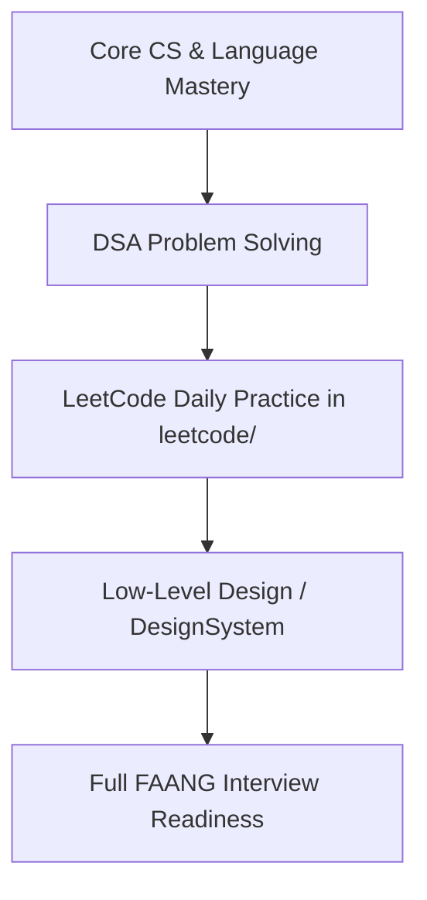

# Data Structures & Algorithms (DSA)

This section serves as the DSA hub for **Crack the Code**. Rather than duplicating problem solutions or creating redundant curricula, all Data Structures and Algorithms practice is integrated with the dedicated **LeetCodeCheck** repository.

---

## 🔗 Integrated Repository

* **Repository**: [`SUSHIL1312/LeetCodeCheck`](https://github.com/SUSHIL1312/LeetCodeCheck.git)
* **Local Path**: [`leetcode/`](./leetcode)

---

## 🛠️ Submodule Setup & Usage

The `leetcode/` directory is linked as a Git submodule. When cloning **Crack the Code** for the first time, initialize and update the submodule using:

```bash
# Clone with submodules
git clone --recursive https://github.com/SUSHIL1312/crack-the-code.git

# Or if already cloned, initialize and fetch submodule contents:
git submodule init
git submodule update --remote --merge
```

### Pulling the Latest LeetCode Solutions
To sync the submodule with the latest commits from the upstream repository:
```bash
cd dsa/leetcode
git pull origin main
cd ../..
```

---

## 🎯 How DSA Fits into Interview Preparation

DSA forms the primary algorithmic evaluation in FAANG technical screens:



1. **Foundations**: Use the C++ and Python sections in this repository (`languages/modern-cpp` and `languages/python`) to master memory models, STL/collections internals, and complexity trade-offs.
2. **Execution**: Practice patterns (Two Pointers, Sliding Window, Monotonic Stack, Binary Search, Trees, Graphs, Dynamic Programming) directly inside [`leetcode/`](./leetcode).
3. **No Duplication**: All code commits, problem breakdowns, and test cases for algorithmic puzzles belong in [`leetcode/`](./leetcode).
