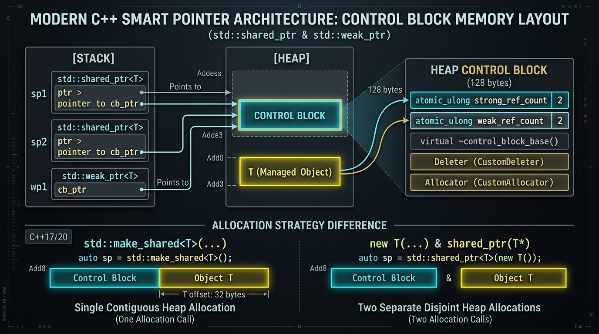

# Module 03: Smart Pointers Internals

<!-- Chapter Navigation Header -->
| ⬅️ [02: RAII & Rule of Five](../02-raii-and-rule-of-five/README.md) | 🏠 [Modern C++ Hub](../README.md) | [04: Polymorphism & Vtables](../04-polymorphism-and-vtables/README.md) ➡️ |
|:---|:---:|---:|
<!-- /Chapter Navigation Header -->

## 1. `std::unique_ptr` Internals
- **Ownership**: Exclusive, single owner.
- **Overhead**: `sizeof(std::unique_ptr<T>) == sizeof(T*)` (Zero overhead!).
  - Compilers use the **Empty Base Optimization (EBO)** or `[[no_unique_address]]` so stateless custom deleters occupy 0 bytes.
- **Copying**: Copy constructor and copy assignment are `= delete`. Ownership can only be transferred via `std::move`.

---

## 2. `std::shared_ptr` & Control Block Architecture

- **Ownership**: Shared, reference-counted ownership.
- **Memory Layout**: A `std::shared_ptr` consists of two 8-byte pointers (16 bytes total on stack):
  1. Pointer to the managed object `T*`.
  2. Pointer to the heap-allocated **Control Block**.
- **Control Block Anatomy**:
  - `atomic<uint32_t> use_count`: Number of active `shared_ptr` instances.
  - `atomic<uint32_t> weak_count`: Number of active `weak_ptr` instances.
  - Custom deleter & Custom allocator.

### `make_shared` vs `new`:
- `shared_ptr<T>(new T)`: Performs **2 separate heap allocations** (one for `T`, one for the Control Block). Cache unfriendly.
- `make_shared<T>()`: Performs **1 single contiguous heap allocation** for both `T` and the Control Block. Faster and more cache-friendly!
  - *Caveat*: If a `weak_ptr` outlives all `shared_ptr`s, the memory for `T` is destroyed, but the block cannot be deallocated until all `weak_ptr`s are destroyed.

---

## 3. `std::weak_ptr` and Breaking Cycles
If Object A holds a `shared_ptr` to Object B, and Object B holds a `shared_ptr` to Object A:
- Neither `use_count` can ever reach 0.
- **Memory Leak!**
- Solution: Make one of the references a `std::weak_ptr`.
- `weak_ptr` observes an object without incrementing `use_count`. Call `.lock()` to safely acquire a temporary `shared_ptr`.

---

<!-- Chapter Navigation Footer -->
| ⬅️ Previous Chapter | 🏠 Up to Track Hub | Next Chapter ➡️ |
|:---|:---:|---:|
| [02: RAII & Rule of Five](../02-raii-and-rule-of-five/README.md) | [Modern C++ Hub](../README.md) | **[04: Polymorphism & Vtables](../04-polymorphism-and-vtables/README.md)** |
<!-- /Chapter Navigation Footer -->

