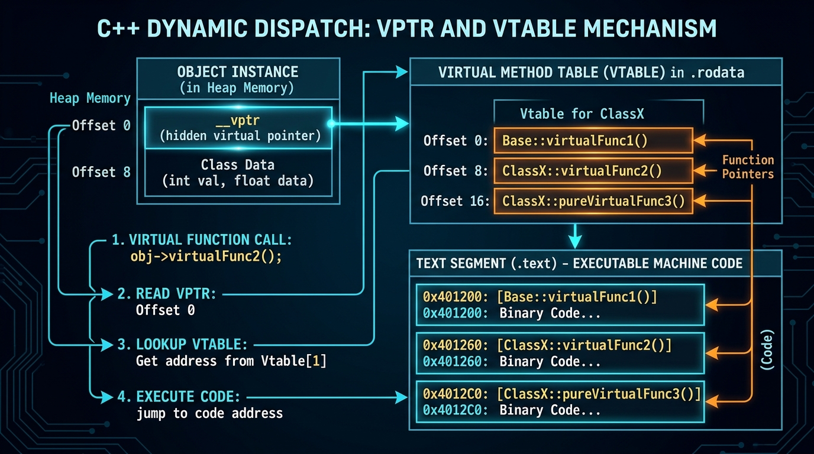
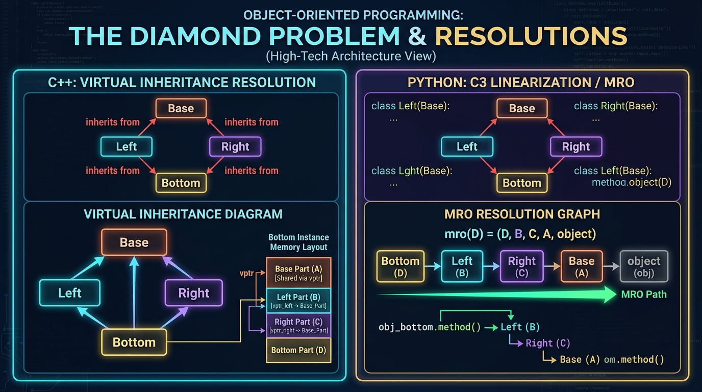

# 🏛️ Object-Oriented Programming (OOP): C++ & Python Engineering Guide

Welcome to the **Object-Oriented Programming (OOP)** interview and systems mastery curriculum. 

Most software engineering tutorials treat OOP superficially with simplistic "Cat/Dog" animal hierarchies without exploring what happens to memory, instruction cache, and assembly dispatch at the hardware or runtime level. In tier-1 engineering interviews (Google, Meta, Apple, Amazon, Netflix, Microsoft), interviewers probe **under-the-hood mechanics**, memory layouts, dispatch overhead, and tricky language edge cases.

This curriculum provides a deep, production-grade examination of OOP across two major engineering paradigms:
1. **Modern C++ (C++17/20/23)**: Compiled, zero-overhead abstraction, explicit memory layout, virtual tables (`vtable`), and deterministic RAII destruction.
2. **Python (3.12+/3.13)**: Dynamic, expressive, runtime introspection, C3 Linearization (`MRO`), cooperative `super()`, and CPython object models (`PyObject`).

---

## 🖼️ Architectural Visualizations

### 1. C++ Dynamic Dispatch: Vptr & Vtable Architecture
In C++, dynamic polymorphism is achieved through compiler-generated virtual method tables (`vtable`) in read-only memory and a hidden pointer (`vptr`) placed at offset 0 of each polymorphic object.



### 2. The Diamond Problem & Resolutions: C++ vs. Python
When two derived classes inherit from a common base and are subsequently inherited by a fourth class, ambiguity and duplication arise. C++ resolves this via **Virtual Inheritance** (single shared base subobject via offset calculation), while Python resolves this via **C3 Linearization** (Method Resolution Order).



---

## ⚖️ Comprehensive Comparative Matrix: C++ vs. Python OOP

| Architectural Dimension | Modern C++ (C++20/23) | Python (3.12+/3.13) |
| :--- | :--- | :--- |
| **Execution Model** | Ahead-of-time (AOT) compiled to machine code | Interpreted bytecode on CPython virtual machine |
| **Object Representation** | Contiguous struct in memory; contains raw member bytes + optional `vptr` (8 bytes) | Heap-allocated `PyObject` (`ob_refcnt`, `ob_type`, attributes dict/slots) |
| **Dispatch Mechanism** | Single/Double pointer indirection via `vtable` (`call *0x8(%rax)`) | Dynamic hash-table lookup in `__dict__` or descriptor traversal along MRO |
| **Dispatch Cost** | ~1-2 ns (predictable branch target, potential cache miss) | ~30-100 ns (hash calculation, dictionary probe, Python frame push) |
| **Memory Footprint** | Minimal: `sizeof(members) + sizeof(vptr) + padding` | Heavy: `PyObject` header (16B) + `__dict__` (~100B+) unless using `__slots__` |
| **4 Pillars: Encapsulation** | Strict compiler enforcement (`public`, `protected`, `private`) | By convention (`_protected`, `__mangled`), no true private memory safety |
| **4 Pillars: Abstraction** | Abstract Base Classes with pure virtual methods (`= 0`) | `abc.ABC` with `@abstractmethod`, or structural `typing.Protocol` |
| **4 Pillars: Polymorphism** | Runtime (`virtual`), Compile-time (Templates, CRTP, Concepts) | Duck typing ("If it quacks like a duck"), runtime method binding |
| **Multiple Inheritance** | Virtual inheritance (`virtual public Base`), pointer adjustments | C3 Linearization Algorithm (`Class.__mro__`), cooperative `super()` |
| **Constructor Dispatch** | Virtual dispatch **disabled** during construction/destruction | Dynamic dispatch **active** during `__init__` |
| **Object Lifetime** | Deterministic RAII (destructor runs immediately on scope exit) | Non-deterministic reference counting + cyclic Garbage Collector |

---

> [!TIP]
> **📖 Choose Your Learning Track**:
> - **Modern C++ Track**: Start with **[Chapter 01: Four Pillars in Modern C++](cpp/01-four-pillars-in-cpp.md)** $\to$ follow the **Next Chapter ➡️** buttons through all 6 chapters.
> - **Python Track**: Start with **[Chapter 01: Python Data Model & Object Creation](python/01-python-data-model-and-classes.md)** $\to$ follow the **Next Chapter ➡️** buttons through all 6 chapters.

## 📂 Curriculum Navigation

```
languages/oops/
├── README.md                                  # You are here: Comparative Master Guide
├── diagrams/                                  # High-resolution architectural diagrams
│   ├── vtable_memory_layout.jpg
│   └── diamond_inheritance_mro.jpg
│
├── cpp/                                       # ⚡ Modern C++ OOP Deep-Dive
│   ├── README.md                              # C++ Curriculum Overview & Roadmap
│   ├── 01-four-pillars-in-cpp.md              # Encapsulation, Abstraction, Inheritance, Polymorphism
│   ├── 02-virtual-functions-and-vtables.md    # Vptr, Vtable, Pure Virtual, Assembly Analysis
│   ├── 03-virtual-destructors-and-slicing.md  # Virtual Dtor rules, Object Slicing, Clone Idiom
│   ├── 04-multiple-inheritance-and-diamond.md # Diamond Problem, Virtual Inheritance, Pointer Shifts
│   ├── 05-static-vs-dynamic-polymorphism.md   # CRTP, C++20 Concepts, Zero-Cost Compile-time Dispatch
│   ├── 06-faang-tricky-interview-questions.md  # Top 10 High-Yield FAANG Tricky C++ Questions
│   └── code/                                  # Runnable C++ Test Labs (make test)
│       ├── vtable_inspection.cpp              # Inspect raw vptr & memory addresses
│       ├── virtual_dtor_leak.cpp              # Memory leak reproduction & resolution
│       ├── object_slicing_demo.cpp            # Object slicing demonstration & clone pattern
│       ├── diamond_virtual_inheritance.cpp    # Virtual base offset & pointer adjustment
│       └── Makefile                           # Automated test runner
│
└── python/                                    # 🐍 Python OOP Deep-Dive
    ├── README.md                              # Python Curriculum Overview & Roadmap
    ├── 01-python-data-model-and-classes.md    # PyObject, __new__ vs __init__, Self, Attribute Lookup
    ├── 02-inheritance-mro-and-super.md        # C3 Linearization, MRO Graph, Cooperative super()
    ├── 03-polymorphism-and-duck-typing.md     # Duck Typing, ABCs (abc.ABC), Protocol (PEP 544)
    ├── 04-memory-optimization-slots.md        # __dict__ vs __slots__, Memory Benchmarks
    ├── 05-metaclasses-and-class-creation.md   # Metaclasses, type(), Class Construction Lifecycle
    ├── 06-faang-tricky-interview-questions.md # Top 10 High-Yield FAANG Tricky Python Questions
    └── code/                                  # Runnable Python Test Labs (make test)
        ├── mro_and_super_demo.py              # C3 Linearization & cooperative super() tests
        ├── new_vs_init_singleton.py           # Thread-safe Singleton & immutable subclassing
        ├── slots_memory_benchmark.py          # RAM benchmark: __dict__ vs __slots__
        ├── test_oop_labs.py                   # Automated unittest suite
        └── Makefile                           # Automated test runner
```

---

## 🎯 How to Prepare for Interviews

1. **For Systems / Infrastructure / Low-Latency Roles (Google, Meta, Apple, NVIDIA, Qualcomm)**:
   - Study [`cpp/02-virtual-functions-and-vtables.md`](cpp/02-virtual-functions-and-vtables.md) and [`cpp/03-virtual-destructors-and-slicing.md`](cpp/03-virtual-destructors-and-slicing.md).
   - Be ready to draw the object memory layout on the whiteboard, explain why calling a virtual function inside a constructor does not dynamically dispatch, and explain pointer adjustments under multiple inheritance.
   - Run the code in `cpp/code/` with `make test`.

2. **For Backend / Platform / Machine Learning Infrastructure Roles (Amazon, Netflix, Uber, Meta)**:
   - Study [`python/02-inheritance-mro-and-super.md`](python/02-inheritance-mro-and-super.md) and [`python/04-memory-optimization-slots.md`](python/04-memory-optimization-slots.md).
   - Be ready to manually calculate the C3 Linearization order of a diamond graph, explain how `super()` passes control laterally, and explain why `__new__` is needed for singletons and immutable types.
   - Run the code in `python/code/` with `make test`.
