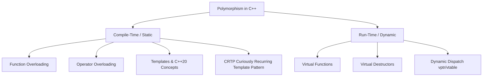

# 🏛️ Module 01: The Four Pillars of OOP in Modern C++

<!-- Chapter Navigation Header -->
| ⬅️ Start of Track | 🏠 [C++ OOP Guide](README.md) | [02: Virtual Functions & Vtables](02-virtual-functions-and-vtables.md) ➡️ |
|:---|:---:|---:|
<!-- /Chapter Navigation Header -->

In systems programming, the four classical OOP pillars—**Encapsulation, Abstraction, Inheritance, and Polymorphism**—are tightly coupled with **memory layout, cache locality, compiler inlining, and binary interfaces (ABI)**.

---

## 1. Encapsulation: Memory Layout & Access Specifiers

Encapsulation bundles data members with member functions and enforces boundaries via access specifiers (`public`, `protected`, `private`).

### `struct` vs `class` in C++: What is the Real Difference?
In C++, `struct` and `class` are **functionally identical** under the hood:
- The **only** difference is default accessibility:
  - In a `struct`, members and base classes are `public` by default.
  - In a `class`, members and base classes are `private` by default.
- Both generate identical machine code, have identical memory layout, support virtual functions, constructors, destructors, and inheritance.

```cpp
struct Foo { int a; };   // 'a' is public
class  Bar { int a; };   // 'a' is private
```

### Memory Layout & Alignment Padding
Encapsulated member variables are laid out sequentially in memory in the order they are declared. Compilers insert padding bytes to satisfy CPU architecture alignment rules:

```cpp
class BadLayout {
    char a;      // 1 byte
                 // 3 bytes padding
    int b;       // 4 bytes
    char c;      // 1 byte
                 // 7 bytes padding
    double d;    // 8 bytes
}; // sizeof = 24 bytes

class OptimizedLayout {
    double d;    // 8 bytes
    int b;       // 4 bytes
    char a;      // 1 byte
    char c;      // 1 byte
                 // 2 bytes padding
}; // sizeof = 16 bytes (33% memory reduction!)
```

> [!TIP]
> **FAANG Interview Tip**: Order class member variables from largest alignment requirement to smallest to eliminate unnecessary internal padding and maximize CPU cache line efficiency.

### Object Lifecycle: Copy Constructor, Shallow Copy vs. Deep Copy

In C++, creating an object from another object triggers the **Copy Constructor**:
```cpp
ClassName(const ClassName& other);
```

#### 1. Why `const ClassName&` (Why pass by reference)?
- If passed by value (`ClassName(ClassName other)`), creating the function parameter `other` requires calling the copy constructor, which passes by value, which calls the copy constructor... $\to$ **Infinite compile-time recursion!** The C++ compiler raises a mandatory compiler error.
- Passing `const ClassName&` avoids any copying and allows binding to temporary rvalues.

#### 2. Shallow Copy vs. Deep Copy:
- **Shallow Copy (Compiler Default)**:
  Copies raw bitwise member values. If a class contains a heap pointer `int* data_`, the copied object receives the *exact same address*.
  - **Catastrophic Double-Free Trap**: When both objects destruct, `delete[] data_` is called twice on the same pointer $\to$ `SIGABRT` crash (`free(): double free detected`)!
- **Deep Copy (Explicit Implementation)**:
  Allocates a brand new heap block and copies the contents. Both objects manage their own independent memory buffers.

#### 3. C++14 Deep Copy Constructor & Copy Assignment Example:
```cpp
class VectorBuffer {
    int* buffer_;
    size_t size_;
public:
    explicit VectorBuffer(size_t size) 
        : buffer_(size ? new int[size]() : nullptr), size_(size) {}

    ~VectorBuffer() { delete[] buffer_; }

    // Deep Copy Constructor (C++14)
    VectorBuffer(const VectorBuffer& other)
        : buffer_(other.size_ ? new int[other.size_] : nullptr), size_(other.size_) {
        if (buffer_ && other.buffer_) {
            std::copy(other.buffer_, other.buffer_ + other.size_, buffer_);
        }
    }

    // Deep Copy Assignment Operator with Self-Assignment Guard (C++14)
    VectorBuffer& operator=(const VectorBuffer& other) {
        if (this == &other) return *this; // Prevent self-destruction on v = v!

        int* new_buf = other.size_ ? new int[other.size_] : nullptr;
        if (new_buf && other.buffer_) {
            std::copy(other.buffer_, other.buffer_ + other.size_, new_buf);
        }

        delete[] buffer_; // Free old memory
        buffer_ = new_buf;
        size_ = other.size_;
        return *this;
    }
};
```

---

## 2. Abstraction: Interfaces & The PIMPL Idiom

Abstraction exposes *what* an entity does while hiding *how* it does it.

### Pure Abstract Classes (Interfaces)
C++ has no explicit `interface` keyword. An interface is defined as an Abstract Base Class (ABC) where:
1. All member functions are **pure virtual** (`virtual void foo() = 0;`).
2. The destructor is **virtual and default** (`virtual ~Interface() = default;`).
3. No member variables are declared.

```cpp
class IEngine {
public:
    virtual ~IEngine() = default;
    virtual void start() = 0;
    virtual void stop() = 0;
    virtual int get_rpm() const = 0;
};
```

### The PIMPL Idiom (Pointer to Implementation)
In large systems (e.g., Chromium, LLVM), changing a private member variable in a header file forces re-compilation of every file that includes that header. The **PIMPL idiom** abstracts implementation details behind an opaque pointer:

```cpp
// NetworkClient.h
#include <memory>

class NetworkClient {
public:
    NetworkClient();
    ~NetworkClient(); // Must be defined in .cpp where Impl is complete
    void send_payload(const std::string& data);

private:
    struct Impl;                  // Forward declaration
    std::unique_ptr<Impl> pimpl;  // Opaque pointer
};
```

```cpp
// NetworkClient.cpp
#include "NetworkClient.h"
#include <openssl/ssl.h> // Heavy header isolated to .cpp!

struct NetworkClient::Impl {
    SSL_CTX* ssl_ctx;
    int socket_fd;
    void do_handshake() { /* ... */ }
};

NetworkClient::NetworkClient() : pimpl(std::make_unique<Impl>()) {}
NetworkClient::~NetworkClient() = default;
void NetworkClient::send_payload(const std::string& data) {
    pimpl->do_handshake();
}
```

---

## 3. Inheritance: Public, Protected, and Private

Most developers only know `public` inheritance. C++ provides three types of inheritance with fundamentally different meanings:

| Inheritance Mode | Meaning | Public in Base Becomes | Protected in Base Becomes | Private in Base Becomes |
| :--- | :--- | :--- | :--- | :--- |
| **`public`** | **IS-A** relationship | `public` | `protected` | Hidden |
| **`protected`** | Restricted IS-A | `protected` | `protected` | Hidden |
| **`private`** | **Implemented-In-Terms-Of** | `private` | `private` | Hidden |

### Composition over Inheritance
Always prefer composition over inheritance unless polymorphic substitution is explicitly needed:
- **`public` inheritance**: `Car` *is-a* `Vehicle` (Liskov Substitution Principle).
- **Composition**: `Car` *has-an* `Engine` (decoupled, swappable at runtime).
- **`private` inheritance**: Used only when you need access to protected base members, need to override virtual functions, or require Empty Base Optimization (EBO).

```cpp
// Private inheritance: implemented-in-terms-of
class Stack : private std::vector<int> {
public:
    void push(int x) { this->push_back(x); }
    void pop()       { this->pop_back(); }
    int  top() const { return this->back(); }
    using std::vector<int>::size;
    using std::vector<int>::empty;
    // std::vector methods like insert() or operator[] are NOT exposed publicly!
};
```

---

## 4. Polymorphism: Compile-Time vs Run-Time

Polymorphism ("many forms") enables a single interface to control different underlying implementations.



### Static vs. Dynamic Comparison

| Characteristic | Compile-Time (Static) | Run-Time (Dynamic) |
| :--- | :--- | :--- |
| **Mechanism** | Templates, Function Overloads, CRTP | Virtual functions, `vtable`, `vptr` |
| **Dispatch Timing** | Resolved at compile time by compiler | Resolved at runtime via pointer indirection |
| **Runtime Overhead** | Zero overhead. Full compiler inlining | ~1-2 ns pointer load + indirect jump; potential cache miss |
| **Object Size Overhead**| 0 extra bytes | +8 bytes (`vptr`) per object |
| **Flexibility** | Types must be known at compile time | Decoupled; can load shared libraries / plugins dynamically |

---

<!-- Chapter Navigation Footer -->
| ⬅️ Previous Chapter | 🏠 Up to Track Hub | Next Chapter ➡️ |
|:---|:---:|---:|
| None (Track Start) | [C++ OOP Guide](README.md) | **[02: Virtual Functions & Vtables](02-virtual-functions-and-vtables.md)** |
<!-- /Chapter Navigation Footer -->

