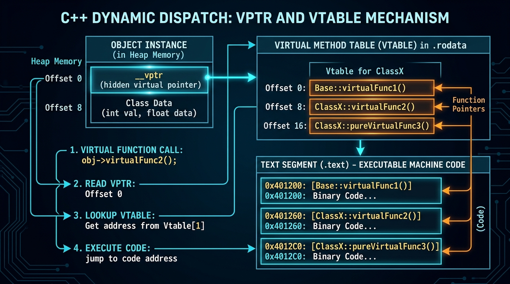

# ⚡ Module 02: Virtual Functions, Vtables, and Dynamic Dispatch

Dynamic polymorphism in C++ is implemented using **Virtual Method Tables (`vtable`)** and **Virtual Pointers (`vptr`)**. This module breaks down the exact memory layout, assembly instructions, performance tradeoffs, and critical interview traps.

---

## 1. Architectural Blueprint: The Vtable Mechanism



When a class declares or inherits at least one virtual function:
1. **The Vtable (`.rodata`)**: The compiler generates a static array of function pointers stored in read-only memory for that class.
2. **The Vptr (Object Offset 0)**: The compiler injects a hidden pointer (`vptr`, 8 bytes on 64-bit systems) at the very beginning of the object's memory layout.
3. **Constructor Initialization**: The class constructor initializes this `vptr` to point to the class's corresponding `vtable`.

---

## 2. Memory Layout Breakdown

Consider the following class hierarchy:

```cpp
class Base {
public:
    int x{10};
    virtual void func1() { std::cout << "Base::func1\n"; }
    virtual void func2() { std::cout << "Base::func2\n"; }
    virtual ~Base() = default;
};

class Derived : public Base {
public:
    int y{20};
    void func1() override { std::cout << "Derived::func1\n"; } // Overrides func1
    virtual void func3() { std::cout << "Derived::func3\n"; } // New virtual function
};
```

### Memory Footprint on 64-bit Architecture:

```text
[ Derived Object in Memory (Total: 24 bytes) ]
+-------------------------+ Offset 0:  vptr (8 bytes) ---> Points to Derived's vtable
|  __vptr                 | 
+-------------------------+ Offset 8:  Base::x (4 bytes)
|  int x = 10             | 
+-------------------------+ Offset 12: Alignment padding (4 bytes)
|  [padding]              | 
+-------------------------+ Offset 16: Derived::y (4 bytes)
|  int y = 20             | 
+-------------------------+ Offset 20: Alignment padding (4 bytes)
|  [padding]              | 
+-------------------------+

[ Derived's Vtable in .rodata ]
+-------------------------+ Slot 0: &Derived::func1()   (Overridden)
|  &Derived::func1        | 
+-------------------------+ Slot 1: &Base::func2()      (Inherited from Base)
|  &Base::func2           | 
+-------------------------+ Slot 2: &Derived::~Derived() (Virtual destructor)
|  &Derived::~Derived     | 
+-------------------------+ Slot 3: &Derived::func3()   (Derived-specific)
|  &Derived::func3        | 
+-------------------------+
```

---

## 3. Dissecting the Assembly: What Happens During `ptr->func1()`?

Given a pointer call:
```cpp
Base* ptr = new Derived();
ptr->func1();
```

The compiler transforms `ptr->func1()` into three distinct machine-level operations:

```nasm
; rdi contains the address of the object ('ptr')
movq    (%rdi), %rax        ; 1. Load the vptr from offset 0 of the object into %rax
movq    (%rax), %rdx        ; 2. Fetch the function pointer from vtable slot 0 into %rdx
callq   *%rdx               ; 3. Indirect call: Jump to the address in %rdx (Derived::func1)
```

### The Performance Cost of Virtual Functions:
1. **Memory Overhead**: Every object instance incurs an extra 8 bytes (`sizeof(vptr)`).
2. **Double Indirection**: Requires two dependent memory loads before jumping to the function.
3. **Cache Miss Risk**: The object is in heap/stack cache; the `vtable` is in `.rodata`; the code is in `.text`. This spans 3 distinct memory regions!
4. **Branch Misprediction**: The CPU branch target buffer (BTB) cannot easily predict indirect function calls (`callq *%rdx`).
5. **Inlining Barrier**: The compiler cannot inline virtual calls when invoked through a base pointer/reference because the target is unknown at compile time.

---

## 4. Pure Virtual Functions & The Purecall Crash

A **pure virtual function** has no implementation in the base class and must be overridden by concrete derived classes:

```cpp
class Shape {
public:
    virtual double area() const = 0; // Pure virtual
};
```

### What is `__cxa_pure_virtual`?
When a pure virtual function is declared, the compiler places a pointer to a runtime dummy function (`__cxa_pure_virtual`) in that vtable slot. If this dummy function is ever invoked, it prints an error and terminates immediately:
```text
pure virtual method called
terminate called without an active exception
Aborted (core dumped)
```

---

## 5. `override` and `final` Specifiers (C++11)

### Why You Must ALWAYS Use `override`:
Without `override`, minor signature mismatches silently create a **new** non-virtual or non-overriding function instead of overriding the base method:

```cpp
class Base {
public:
    virtual void process(const std::string& s) const;
};

class Derived : public Base {
public:
    // BUG: Missing 'const'! Without 'override', this compiles cleanly but DOES NOT override!
    // With 'override', the compiler produces an immediate build error.
    void process(const std::string& s) override; // ERROR: marked override but does not override
};
```

### `final`: Preventing Inheritance & Enabling Devirtualization
- `final` on a class prevents further inheritance: `class FinalClass final : public Base {};`
- `final` on a method prevents further overriding: `void foo() override final;`
- **Compiler Optimization (Devirtualization)**: When the compiler sees `final`, it knows no further subclasses can override the method. It converts the indirect virtual call into a **direct, statically dispatched call** and can inline it!
