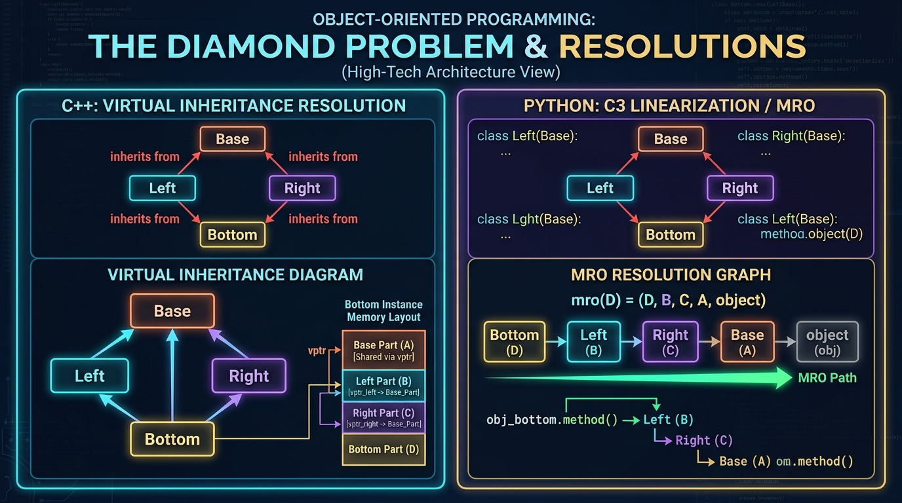

# ⚡ Module 04: Multiple Inheritance, Pointer Adjustments, and the Diamond Problem

<!-- Chapter Navigation Header -->
| ⬅️ [03: Virtual Destructors & Slicing](03-virtual-destructors-and-slicing.md) | 🏠 [C++ OOP Guide](README.md) | [05: Static vs Dynamic Polymorphism](05-static-vs-dynamic-polymorphism.md) ➡️ |
|:---|:---:|---:|
<!-- /Chapter Navigation Header -->

Multiple inheritance introduces subtle low-level complexities: **multiple virtual pointers (`vptr`), non-zero `this` pointer adjustments, and state duplication in the Diamond Problem**.

---

## 1. Multiple Inheritance Memory Layout & `this` Pointer Adjustments

When a class inherits from multiple base classes, it contains distinct subobjects for each base class laid out sequentially:

```cpp
class Base1 {
public:
    int b1{10};
    virtual void func1() {}
};

class Base2 {
public:
    int b2{20};
    virtual void func2() {}
};

class Derived : public Base1, public Base2 {
public:
    int d{30};
    void func1() override {}
    void func2() override {}
};
```

### Memory Layout in RAM (64-bit):
```text
[ Derived Object Instance (32 bytes) ]
+-------------------------+ Offset 0:  vptr_Base1 (8 bytes) ---> Derived's Primary Vtable
|  __vptr_Base1           | 
+-------------------------+ Offset 8:  Base1::b1 (4 bytes) + 4 bytes padding
|  int b1 + [padding]     | 
+-------------------------+ Offset 16: vptr_Base2 (8 bytes) ---> Secondary Vtable (Base2-in-Derived)
|  __vptr_Base2           | 
+-------------------------+ Offset 24: Base2::b2 (4 bytes)
|  int b2                 | 
+-------------------------+ Offset 28: Derived::d (4 bytes)
|  int d                  | 
+-------------------------+
```

### The `this` Pointer Adjustment Trap:
If you cast a `Derived*` to `Base2*`, the compiler must adjust the raw pointer value by `+16` bytes:

```cpp
Derived* d = new Derived();
Base1* b1 = d;                   // Address is IDENTICAL to 'd' (offset 0)
Base2* b2 = d;                   // Address is SHIFTED by +16 bytes!

std::cout << "d  = " << (void*)d  << "\n";
std::cout << "b1 = " << (void*)b1 << "\n";
std::cout << "b2 = " << (void*)b2 << "\n"; // Notice b2 != d!
```

> [!CAUTION]
> **FAANG Trap**: Never use `reinterpret_cast` or C-style void pointer casts across multiple inheritance! Always use `static_cast` or `dynamic_cast` so the compiler can apply the appropriate pointer offset adjustment.

---

## 2. The Diamond Problem & Virtual Inheritance



When two derived classes inherit from a common base and are subsequently inherited together, a diamond graph forms:

```text
       [ Device ]
       /        \
  [ Printer ]  [ Scanner ]
       \        /
      [ Copier ]
```

### The Non-Virtual Diamond (The Problem):
```cpp
class Device {
public:
    int power_state{1};
};

class Printer : public Device {};
class Scanner : public Device {};
class Copier  : public Printer, public Scanner {};

Copier c;
// c.power_state = 0; // COMPILER ERROR: Request for member 'power_state' is ambiguous!
c.Printer::power_state = 0; // Must disambiguate manually!
// 'c' contains TWO separate copies of 'Device' (duplicate memory)!
```

### The Fix: Virtual Inheritance (`virtual public Base`)
Virtual inheritance instructs the compiler to share a single common `Device` subobject across the entire hierarchy:

```cpp
class Device {
public:
    int power_state{1};
    Device(int state) : power_state(state) {}
    virtual ~Device() = default;
};

class Printer : virtual public Device {
public:
    Printer() : Device(1) {}
};

class Scanner : virtual public Device {
public:
    Scanner() : Device(1) {}
};

class Copier : public Printer, public Scanner {
public:
    // IMPORTANT: The MOST DERIVED CLASS initializes the virtual base directly!
    Copier() : Device(1), Printer(), Scanner() {}
};
```

### How Virtual Inheritance Works Under the Hood:
1. **Virtual Base Pointer / Offset Table**: The compiler removes the inline base subobject from `Printer` and `Scanner`.
2. Instead, it places the shared `Device` subobject at the **very end** of the `Copier` memory layout.
3. `Printer` and `Scanner` locate `Device` dynamically via a **virtual base offset (`vbase_offset`)** stored in their respective vtables.
4. Calling `c.power_state` resolves unambiguously to the single shared `Device` instance!

### Constructor Execution Order:
In virtual inheritance, the initialization calls to `Device` inside `Printer()` and `Scanner()` are **ignored**. The most derived class (`Copier`) is directly responsible for constructing the shared virtual base `Device`.

---

<!-- Chapter Navigation Footer -->
| ⬅️ Previous Chapter | 🏠 Up to Track Hub | Next Chapter ➡️ |
|:---|:---:|---:|
| [03: Virtual Destructors & Slicing](03-virtual-destructors-and-slicing.md) | [C++ OOP Guide](README.md) | **[05: Static vs Dynamic Polymorphism](05-static-vs-dynamic-polymorphism.md)** |
<!-- /Chapter Navigation Footer -->

