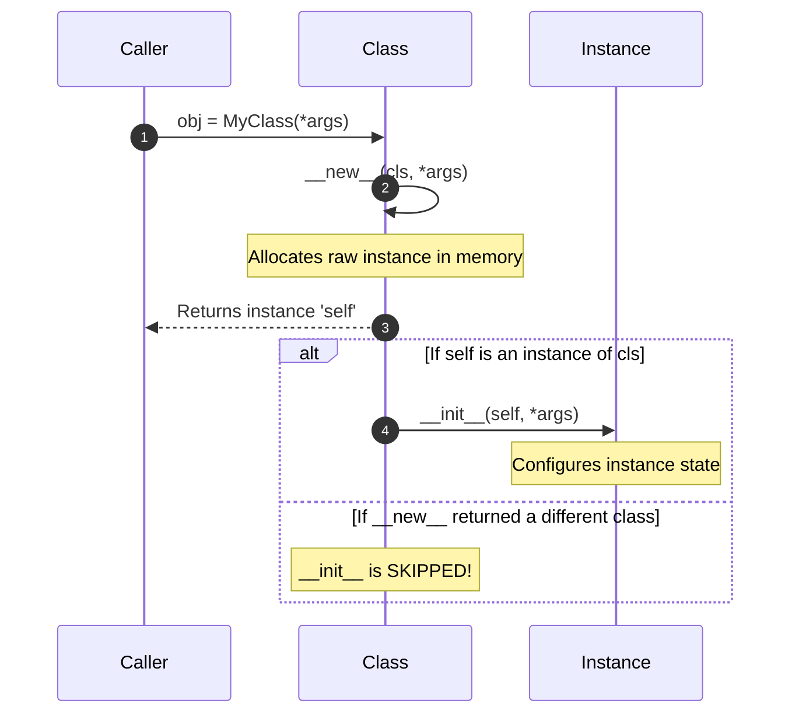

# 🐍 Module 01: Python Data Model & Object Creation Internals

In Python, classes are not mere syntactic templates: **classes are executable runtime statements, and objects are backed directly by CPython's C structures**.

---

## 1. The Anatomy of a Python Object: `PyObject`

At the C level (in `Include/object.h`), every Python entity is an instance of `PyObject`:

```c
struct _object {
    _PyObject_HEAD_EXTRA // Double-linked list pointers for cyclic GC tracking
    Py_ssize_t ob_refcnt; // Reference count for deterministic memory deallocation
    PyTypeObject *ob_type; // Pointer to the type object (e.g., &PyLong_Type)
};
```

1. **`ob_refcnt`**: Tracks how many variables reference this object. When it drops to 0, memory is immediately reclaimed.
2. **`ob_type`**: Dictates the object's behavior (which methods it supports, how it is printed, and how attributes are resolved).

---

## 2. Object Instantiation: `__new__` vs `__init__`

Most developers believe `__init__` is the constructor. That is incorrect. In Python:
- **`__new__` is the actual Constructor**: A static method responsible for allocating and returning the instance.
- **`__init__` is the Initializer**: An instance method responsible for setting up attributes on the newly allocated instance.



### The `__new__` Interception Mechanics:
```python
class PositiveInt(int):
    # 'int' is immutable! Its value CANNOT be set in __init__.
    # It MUST be intercepted in __new__ before memory is frozen.
    def __new__(cls, val):
        if val < 0:
            val = abs(val)
        return super().__new__(cls, val)

p = PositiveInt(-42)
print(p) # 42
```

> [!IMPORTANT]
> **FAANG Trap**: If `__new__` returns an object that is **not** an instance of `cls`, Python **skips calling `__init__` entirely**! This is used in Factory patterns and object pooling.

---

## 3. The Attribute Lookup Resolution Pipeline

When you execute `val = obj.attr`, Python executes a strict 6-stage attribute lookup pipeline:

1. **Invoke `type(obj).__getattribute__(obj, 'attr')`**:
   The primary entry point for attribute retrieval.
2. **Data Descriptor Lookup**:
   Check if `'attr'` exists in `type(obj)` (or any base class along the MRO) and defines both `__get__` and `__set__` (e.g., `@property`). If found, call `descriptor.__get__(obj, type(obj))`.
3. **Instance `__dict__` Lookup**:
   Check if `'attr'` exists in the instance's dictionary (`obj.__dict__['attr']`).
4. **Non-Data Descriptor / Class Attribute Lookup**:
   Check if `'attr'` exists in `type(obj)`'s dictionary:
   - If it is a method or function (non-data descriptor with only `__get__`), invoke `method.__get__(obj, type(obj))` (which binds `self`!).
   - If it is a normal class variable, return it directly.
5. **Fallback to `__getattr__`**:
   If the attribute was not found in steps 2–4, and `type(obj)` defines `__getattr__`, invoke `obj.__getattr__('attr')`.
6. **Raise `AttributeError`**:
   If none of the above succeed, Python raises `AttributeError: 'MyClass' object has no attribute 'attr'`.

---

## 4. Class Variables vs. Instance Variables Shadowing Trap

```python
class Worker:
    tasks = [] # CLASS VARIABLE (Shared across all instances!)

w1 = Worker()
w2 = Worker()

w1.tasks.append("Deploy v1.0")
print(w2.tasks) # ['Deploy v1.0'] -> MUTATED BOTH!

# However, reassignment creates an instance attribute that shadows:
w1.tasks = ["Local Task"] # Creates w1.__dict__['tasks']!
print(w1.tasks) # ['Local Task']
print(w2.tasks) # ['Deploy v1.0'] (Class variable remains intact for w2)
```
