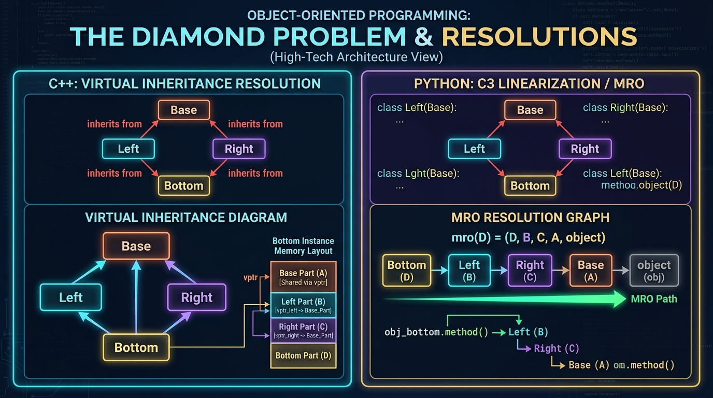

# 🐍 Module 02: Inheritance, MRO & Cooperative `super()`

Python supports multiple inheritance natively. To prevent the ambiguities and state duplications of the **Diamond Problem**, Python uses the mathematically rigorous **C3 Linearization Algorithm** to construct a deterministic **Method Resolution Order (MRO)**.

---

## 1. Architectural Blueprint: C3 MRO vs. C++ Virtual Inheritance



In C++, resolving the diamond problem requires virtual base table offsets and memory shifts. In Python, the runtime flattens the directed acyclic graph (DAG) of classes into a **linear search list** (`Class.__mro__`).

---

## 2. The C3 Linearization Algorithm

When defining `class C(B1, B2, ..., Bn):`, Python calculates its linearization $L(C)$ using the formula:

$$L(C) = [C] + \text{merge}(L(B_1), L(B_2), \dots, L(B_n), [B_1, B_2, \dots, B_n])$$

### The Merge Rules:
1. Look at the head of the first list: `L(B_1)[0]`.
2. If this head is **not in the tail** (any position other than the first) of any other list being merged:
   - Add it to the linearization of $C$.
   - Remove it from all lists in the merge.
3. Otherwise, look at the head of the next list and repeat.
4. If no valid head can be extracted (a cyclic conflict exists), Python raises:
   `TypeError: Cannot create a consistent method resolution order (MRO)`.

### Hand-Calculating the Classic Diamond:
Given:
```python
class A: pass
class B(A): pass
class C(A): pass
class D(B, C): pass
```

1. $L(O) = [O]$ (where $O = \text{object}$)
2. $L(A) = [A, O]$
3. $L(B) = [B, A, O]$
4. $L(C) = [C, A, O]$
5. $L(D) = [D] + \text{merge}(L(B), L(C), [B, C])$
   - $= [D] + \text{merge}([B, A, O], [C, A, O], [B, C])$
   - Head $B$ is not in tails $\implies$ Select $B$:
   - $= [D, B] + \text{merge}([A, O], [C, A, O], [C])$
   - Head $A$ is in the tail of $[C, A, O]$! $\implies$ Skip $A$, test next list head $C$.
   - Head $C$ is not in tails $\implies$ Select $C$:
   - $= [D, B, C] + \text{merge}([A, O], [A, O])$
   - Head $A$ is not in tails $\implies$ Select $A$:
   - $= [D, B, C, A, O]$

Inspect at runtime:
```python
print([cls.__name__ for cls in D.__mro__])
# Output: ['D', 'B', 'C', 'A', 'object']
```

---

## 3. How `super()` Actually Works (The Lateral Dispatch Secret)

> [!CAUTION]
> **Common Fallacy**: "Calling `super()` invokes the parent class."  
> **Truth**: `super()` invokes **the next class in the dynamic instance's MRO**!

In multiple inheritance, `super()` does not move vertically up the tree; it moves **laterally across sibling classes**:

```python
class Root:
    def process(self):
        print("Root.process")

class BranchB(Root):
    def process(self):
        print("BranchB.process START")
        super().process() # Calls BranchC, NOT Root!
        print("BranchB.process END")

class BranchC(Root):
    def process(self):
        print("BranchC.process START")
        super().process() # Calls Root
        print("BranchC.process END")

class Leaf(BranchB, BranchC):
    def process(self):
        print("Leaf.process START")
        super().process() # Calls BranchB
        print("Leaf.process END")

Leaf().process()
```

### Execution Trace:
```text
Leaf.process START
BranchB.process START
BranchC.process START    <-- Notice BranchB called BranchC laterally!
Root.process
BranchC.process END
BranchB.process END
Leaf.process END
```

### Why Bypassing `super()` Causes Catastrophic Bugs:
If `BranchB` or `BranchC` explicitly calls `Root.process(self)` instead of `super().process()`, `Root.process` will execute **twice**! Using `super()` guarantees every class in a diamond hierarchy runs **exactly once**.

### The Cooperative Multiple Inheritance Rule:
Always accept `*args` and `**kwargs` and pass them up with `super().__init__(*args, **kwargs)` to ensure parameters flow cleanly through unknown sibling classes along the MRO.
