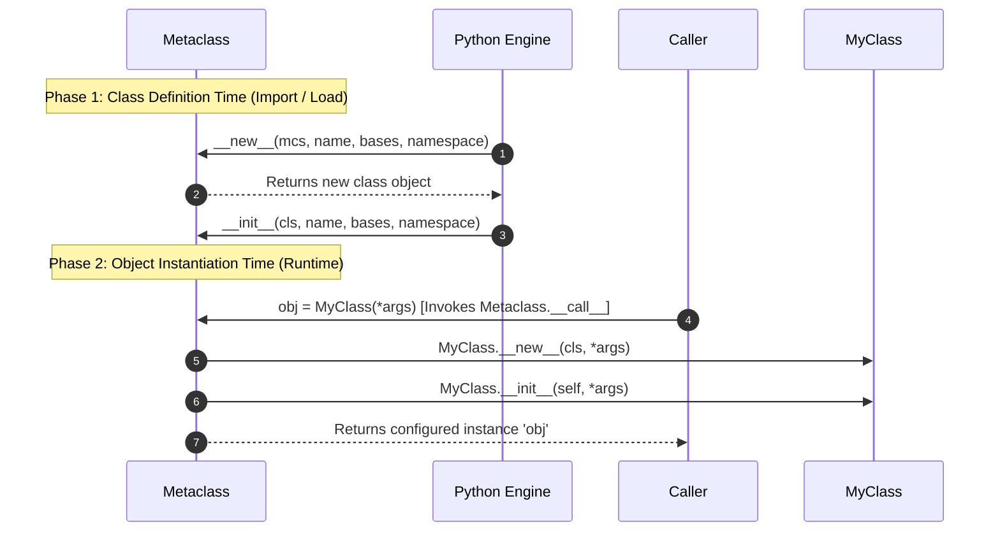

# 🐍 Module 05: Metaclasses & Class Creation Hooks

<!-- Chapter Navigation Header -->
| ⬅️ [04: Memory Optimization & __slots__](04-memory-optimization-slots.md) | 🏠 [Python OOP Guide](README.md) | [06: FAANG Tricky Questions](06-faang-tricky-interview-questions.md) ➡️ |
|:---|:---:|---:|
<!-- /Chapter Navigation Header -->

In Python, classes are first-class runtime objects. **A metaclass is the class of a class**:
- An object is an instance of a **class**.
- A class is an instance of a **metaclass**.

By default, the metaclass for all standard Python classes is **`type`**.

---

## 1. Creating Classes Dynamically with `type`

The standard `class` statement is syntactic sugar for calling `type()` with three arguments:
```python
# type(name: str, bases: tuple, namespace: dict) -> class
def greet(self):
    return f"Hello from {self.name}"

UserClass = type("UserClass", (object,), {"species": "Human", "greet": greet})

u = UserClass()
u.name = "Alice"
print(u.greet()) # "Hello from Alice"
```

---

## 2. Metaclass Lifecycle & Hook Execution

When you define a custom metaclass by inheriting from `type`, you can intercept class creation:



### Production Example: API Contract Enforcement Metaclass
Suppose your framework requires all public methods in service classes to follow strict `snake_case` naming and provide docstrings:

```python
class APIServiceMeta(type):
    def __new__(mcs, name, bases, namespace):
        for attr_name, attr_val in namespace.items():
            if callable(attr_val) and not attr_name.startswith("_"):
                # Enforce snake_case
                if not attr_name.islower():
                    raise TypeError(f"Method '{attr_name}' in '{name}' must be snake_case!")
                # Enforce docstring
                if not attr_val.__doc__:
                    raise ValueError(f"Method '{attr_name}' in '{name}' must have a docstring!")
        return super().__new__(mcs, name, bases, namespace)

class PaymentService(metaclass=APIServiceMeta):
    def process_transaction(self):
        """Process payments securely."""
        pass

    # def processPayment(self): # RAISES TypeError!
    #     pass
```

---

## 3. The Modern Alternative: `__init_subclass__` (PEP 487)

Writing full metaclasses often introduces inheritance conflicts (e.g., `metaclass conflict` when combining multiple libraries). In Python 3.6+, **`__init_subclass__`** provides 90% of metaclass power with zero syntax overhead:

```python
class PluginBase:
    registry = {}

    def __init_subclass__(cls, plugin_name: str, **kwargs):
        super().__init_subclass__(**kwargs)
        if plugin_name in cls.registry:
            raise ValueError(f"Plugin '{plugin_name}' is already registered!")
        cls.registry[plugin_name] = cls

# Subclasses register automatically upon definition!
class JSONPlugin(PluginBase, plugin_name="json"):
    pass

class XMLPlugin(PluginBase, plugin_name="xml"):
    pass

print(PluginBase.registry)
# {'json': <class '__main__.JSONPlugin'>, 'xml': <class '__main__.XMLPlugin'>}
```

> [!TIP]
> **FAANG Recommendation**: Prefer `__init_subclass__` for class validation and plugin registries. Reserve full metaclasses only when you need to intercept attribute dictionary creation (`__prepare__`) or override instance creation (`__call__`).

---

<!-- Chapter Navigation Footer -->
| ⬅️ Previous Chapter | 🏠 Up to Track Hub | Next Chapter ➡️ |
|:---|:---:|---:|
| [04: Memory Optimization & __slots__](04-memory-optimization-slots.md) | [Python OOP Guide](README.md) | **[06: FAANG Tricky Questions](06-faang-tricky-interview-questions.md)** |
<!-- /Chapter Navigation Footer -->

