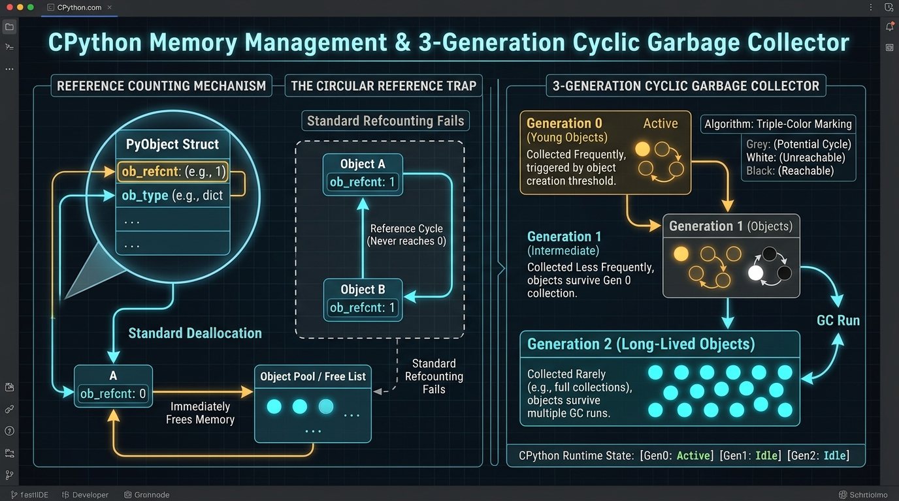

# Module 02: CPython Internals & Garbage Collection

## 1. PyObject Structure & Reference Counting
In the CPython C runtime, every Python object begins with the `PyObject` header:
```c
struct _object {
    _PyObject_HEAD_EXTRA
    Py_ssize_t ob_refcnt;   // 64-bit reference counter
    struct _typeobject *ob_type; // Pointer to type object
};
```
- **Reference Counting**: Whenever a new name points to an object, `ob_refcnt` increments (`Py_INCREF`). When a name goes out of scope or is reassigned, `ob_refcnt` decrements (`Py_DECREF`).
- **Immediate Deallocation**: The instant `ob_refcnt == 0`, the memory is immediately returned. No pause required!

---

## 2. The Fatal Limitation: Circular References
Reference counting cannot detect or collect **reference cycles**:
```python
a = []
b = []
a.append(b)
b.append(a)
del a
del b
```
Even after `del a, b`, both lists retain `ob_refcnt == 1` because they point to each other!

---

## 3. The Generational Cyclic GC



To reclaim cyclic leaks, CPython runs a secondary **Generational Cyclic Garbage Collector**:
- **3 Generations**:
  - **Generation 0**: Newly created container objects. Collected most frequently (triggered when object allocations exceed deallocations by 700).
  - **Generation 1**: Survivors of Gen 0 collection. Collected every 10 Gen 0 collections.
  - **Generation 2**: Long-lived objects (module globals, long-lived caches). Collected least frequently (every 10 Gen 1 collections).
- **Tri-Color Algorithm**: CPython tracks pointer references between container objects (`list`, `dict`, `set`, custom classes). It subtracts internal cross-references: if an isolated graph of cyclic objects has 0 external references, the entire circular cluster is reclaimed to the object pool!
