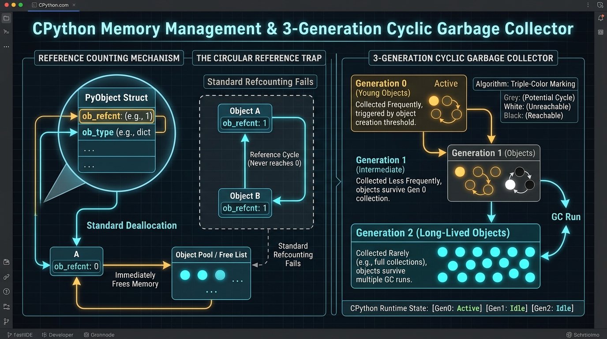

# Python: FAANG Technical Interview Preparation Curriculum

A high-yield, internal-focused Python curriculum designed for software engineers interviewing for backend, systems, and distributed infrastructure roles at **Meta, Google, Stripe, Netflix, and Amazon**.

Focuses on the Python data model, CPython internals, memory management, the GIL, asynchronous concurrency, and production patterns.

> [!TIP]
> **Dedicated OOP Deep Dive**: For complete Python Object-Oriented Programming (PyObject, `__new__` vs `__init__`, C3 Linearization MRO, cooperative `super()`, `__slots__` 70% memory reduction, metaclasses, and FAANG interview questions), visit **[`languages/oops/python/`](../oops/python/)**.

---

## 📚 Curriculum Structure

| Module | Core Concepts | High-Yield Interview Focus |
|---|---|---|
| **[01-data-model-and-dunder-methods](01-data-model-and-dunder-methods/)** | Mutability, pass-by-object-reference, `__new__` vs `__init__`, dunder catalog. | Mutable default arguments trap; hashability vs equality. |
| **[02-cpython-internals-and-gc](02-cpython-internals-and-gc/)** | PyObject header, reference counting, generational cyclic GC, `pymalloc`. | How circular references leak without GC; memory profiling. |
| **[03-gil-and-concurrency](03-gil-and-concurrency/)** | Global Interpreter Lock, CPU vs I/O bound tasks, Threading vs Multiprocessing, Python 3.13 Free-threaded (PEP 703) & JIT (PEP 744). | Why threading doesn't speed up CPU-bound code; GIL release during I/O. |
| **[04-asyncio-and-structured-concurrency](04-asyncio-and-structured-concurrency/)** | Event loop, coroutines, `async`/`await`, `asyncio.TaskGroup`, cooperative multitasking. | Event loop starvation; thread vs async memory footprint. |
| **[05-decorators-generators-and-metaprogramming](05-decorators-generators-and-metaprogramming/)** | Closures, function & class decorators, generator pipelines (`yield`), descriptors. | Writing generic decorators with `functools.wraps`; lazy evaluation. |
| **[06-high-frequency-interview-bank](06-high-frequency-interview-bank/)** | Curated FAANG Python interview questions with battle-tested answers. | Meta, Stripe, and Google Python technical interview traps. |

---

## 🖼️ Architectural Blueprint: CPython Memory & Generational Cyclic GC

### Key Architectural Takeaways for Interviews:
- **`PyObject` Header**: Every Python object has `ob_refcnt` (reference count) and `ob_type` (pointer to type descriptor).
- **Dual Memory Reclamation System**:
  - **Immediate Reference Counting**: Handles 99% of objects ($O(1)$ immediate deallocation when `ob_refcnt == 0`).
  - **Generational Cyclic GC (Gen 0, Gen 1, Gen 2)**: Overcomes the circular reference problem (e.g. `obj_a.ref = obj_b; obj_b.ref = obj_a`). Runs periodically based on allocation thresholds (`gc.get_threshold()`). Surviving objects get promoted to older, less frequently collected generations.

---

## 🛠️ Python Capstone Projects (`projects/`)

1. **`01-async-rate-limiter`**: Token-bucket algorithm with `asyncio.sleep` and sliding window.
2. **`02-lru-cache-decorator`**: Custom LRU cache implementation from scratch using `collections.OrderedDict` or Doubly Linked List + Hash Map.
3. **`03-thread-safe-connection-pool`**: Reusable database connection pool with timeouts and health checks.
4. **`04-custom-context-manager-and-profiler`**: Exception-safe resource manager and CPU execution profiler.
