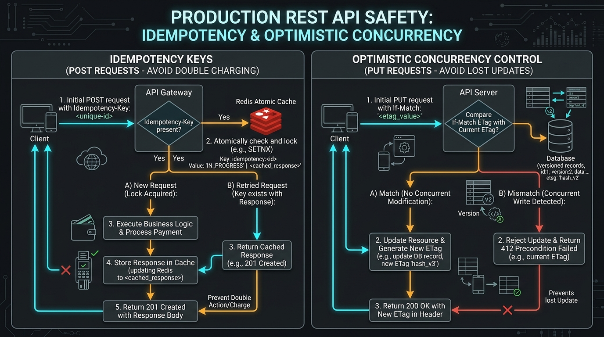

# REST API Design: The Zero-to-Hero Guide

Welcome to the comprehensive, production-grade guide to **REST API Design**. This module covers the end-to-end principles, architectural decisions, and production trade-offs tested in FAANG system design and backend engineering interviews.

> [!TIP]
> **📖 Start Reading Here**: Read sequentially chapter-by-chapter starting with **[Chapter 01: REST Fundamentals](01-rest-fundamentals.md)**. Every chapter includes **Next Chapter ➡️** buttons at the bottom to continue reading!

---

## 📚 Curriculum Roadmap

| Module | Title | Core Concepts |
|---|---|---|
| **[01](01-rest-fundamentals.md)** | **REST Fundamentals** | What is REST? Roy Fielding's 6 constraints explained simply with real-world analogies. |
| **[02](02-resource-modeling-and-uris.md)** | **Resource Modeling & URIs** | Nouns over verbs, hierarchical modeling, path params vs query params, anti-patterns. |
| **[03](03-http-verbs-and-status-codes.md)** | **HTTP Verbs & Status Codes** | GET, POST, PUT, PATCH, DELETE. Safety vs Idempotency matrix. 2xx, 3xx, 4xx, 5xx mastery. |
| **[04](04-what-to-take-care-during-design.md)** | **Production Design Checklist** | **What to take care during design**: Idempotency keys, Offset vs Cursor pagination, Versioning, RFC 7807 errors, Rate limiting, ETags & optimistic locking. |
| **[05](05-end-to-end-design-case-study.md)** | **End-to-End Case Study** | Step-by-step design of an enterprise E-Commerce API (Users, Products, Orders, Payments) with full JSON contracts. |
| **[Examples](examples/)** | **Runnable Reference Server** | Fully runnable Python server (`rest_api_server_demo.py`) implementing cursor pagination, RFC 7807 errors, ETags, and idempotency keys with automated test suite. |
| **[Q&A](interview-questions.md)** | **FAANG Interview Questions** | High-frequency API design questions asked at Google, Meta, Stripe, Amazon, and Uber. |

---

## ⚡ Quick Mental Model: The REST Golden Rules

```
1. Resources are NOUNS, not verbs:
   ✅ GET /orders/42
   ❌ GET /getOrderDetails?id=42

2. Use HTTP verbs for actions:
   - GET: Read resource (Safe, Idempotent)
   - POST: Create subordinate resource (Unsafe, Non-idempotent)
   - PUT: Replace resource completely (Unsafe, Idempotent)
   - PATCH: Modify resource partially (Unsafe, Non-idempotent / Idempotent)
   - DELETE: Remove resource (Unsafe, Idempotent)

3. Status codes speak louder than response bodies:
   - 201 Created (with Location header)
   - 204 No Content (successful deletion)
   - 400 Bad Request (client syntax error)
   - 401 Unauthorized (missing/invalid credentials)
   - 403 Forbidden (authenticated, but insufficient permissions)
   - 404 Not Found (resource does not exist)
   - 409 Conflict (optimistic locking failure / duplicate state)
   - 429 Too Many Requests (rate limited)

4. Never double charge:
   - Always use an Idempotency-Key header on financial / mutating POST endpoints!
```

---

## 🖼️ Architectural Blueprint: Idempotency & Concurrency Control



### Production & FAANG Interview Mechanics:
1. **Idempotency Key Flow (`Idempotency-Key: <UUID>`)**:
   - The API Gateway checks Redis atomically using `SET key token NX EX 86400`.
   - **First Request**: Key is acquired with status `IN_FLIGHT`. Request processes through business logic and payment gateway. Result is cached in Redis with TTL.
   - **Retry While Processing**: Returns `409 Conflict` ("Request currently processing; retry after delay").
   - **Retry After Completion**: Gateway intercepts the request, reads the cached JSON response from Redis, and returns `200/201` without hitting downstream payment processors or database!
2. **Optimistic Concurrency Control (`ETag` & `If-Match`)**:
   - Resolves the classic "Lost Update" race condition when concurrent users attempt to mutate the same resource.
   - Client sends `If-Match: "v1"`.
   - If the resource state changed to `"v2"`, the database transaction rejects the update, returning `412 Precondition Failed` so the client must re-fetch before updating.

